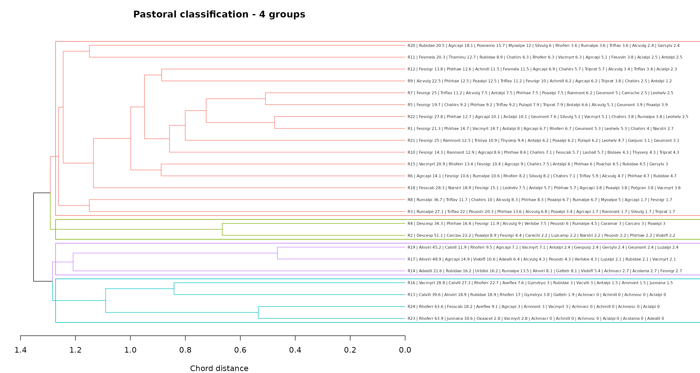
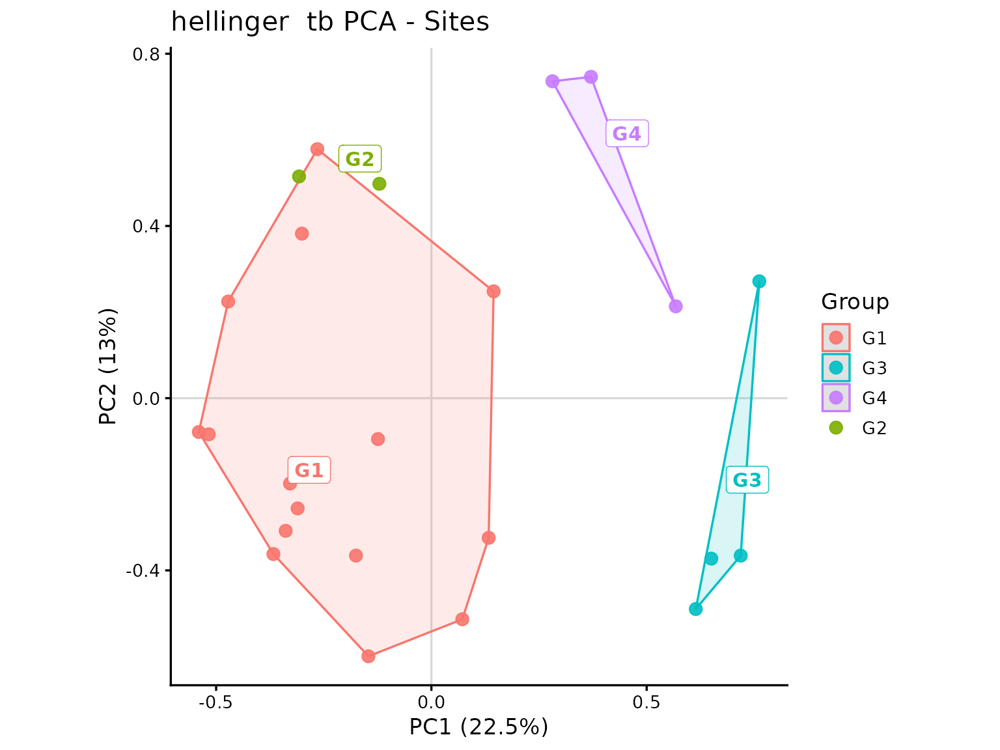
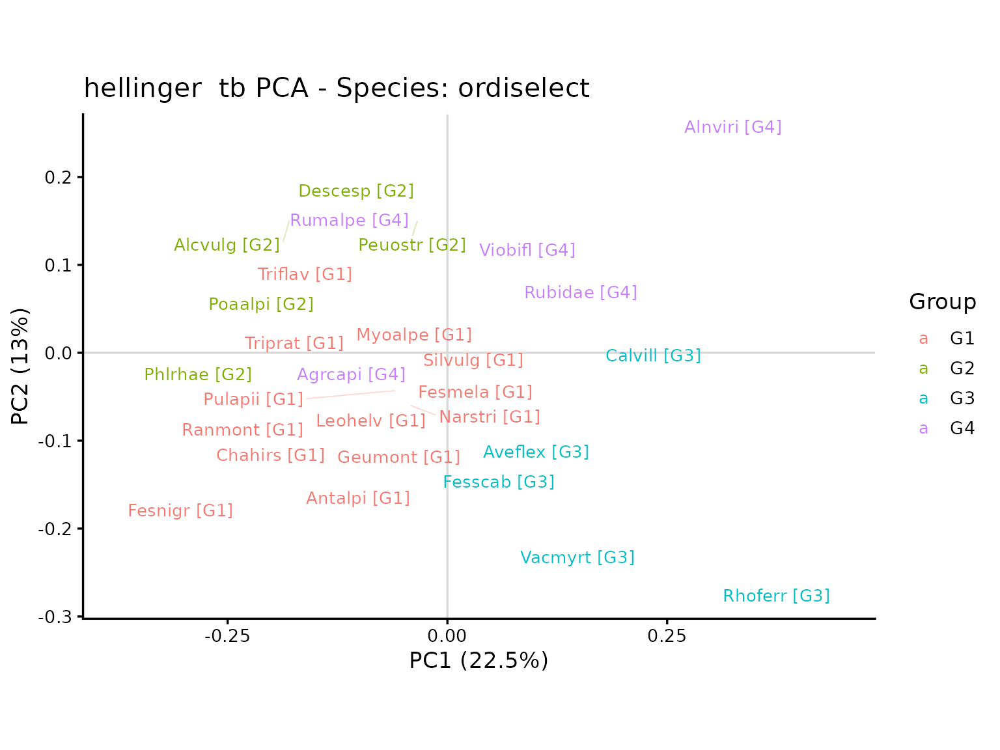

# Vegetation classification: a pastoral approach

Suppose we want to identify vegetation groups that can be interpreted
from the dominant species and their relative abundances. A useful first
step is to display a dendrogram together with the most abundant species
in each survey. This makes it easier to see which surveys share a
similar composition and to decide where to cut the dendrogram.

In this example, we calculate Species Relative Abundance (SRA), run an
agglomerative cluster analysis, and match the first ten species of each
survey to the dendrogram. After choosing a cut, we calculate mean group
composition and explore the groups using transformation-based PCA
(tb-PCA), with species labels selected by `ordiselect`.

## 1. Packages and example data

The example uses
[`iPastoralist::data`](https://rdrr.io/r/utils/data.html). Survey values
are frequencies of occurrence (FO), `999` identifies occasional species,
and empty cells indicate absences. We use species codes to keep
dendrogram labels compact.

``` r

library(iPastoralist)
library(vegan)
library(dendextend)
library(tidyverse)
```

Select species codes and survey columns, excluding ecological indicator
values and other ancillary information. The first column contains the
species codes, as required by
[`vegetation_abundance()`](https://marcopittarello.github.io/iPastoralist/reference/vegetation_abundance.md).

``` r

data_example <- as.data.frame(iPastoralist::data)
vegetation <- data_example[, c(2, 7:ncol(data_example))]
knitr::kable(head(vegetation[, seq_len(min(7L, ncol(vegetation)))]))
```

| species.name.code |  R1 |  R2 |  R3 |  R4 |  R5 |  R6 |
|:------------------|----:|----:|----:|----:|----:|----:|
| Achmacr           |  NA |  NA |  NA |  NA |  NA |  NA |
| Achmill           |  NA |  NA |  NA |  NA |  NA |  NA |
| Achmosc           |  NA |  NA |  NA |  NA |  NA |  NA |
| Acialpi           |  NA |  NA |  NA |  NA |  NA |  NA |
| Acolama           | 999 |  NA |  NA |  NA |  NA |  NA |
| Adealli           |  NA | 999 |  NA |  NA |  NA |  NA |

## 2. Species Relative Abundance

First, calculate SRA from FO. With `method = "SRA_fo"`, occasional
species are excluded and species abundances sum to 100 within each
survey.

``` r

sra <- vegetation_abundance(
  database = vegetation,
  method = "SRA_fo"
)
# For subsequent analyses: rows = surveys; columns = species.
veg <- t(as.matrix(sra))
```

|         |  R1 |  R2 |  R3 |  R4 |  R5 |  R6 |  R7 |  R8 |  R9 | R10 | R11 |  R12 |
|:--------|----:|----:|----:|----:|----:|----:|----:|----:|----:|----:|----:|-----:|
| Achmacr |   0 |   0 |   0 |   0 |   0 |   0 |   0 |   0 | 0.0 |   0 | 0.0 |  0.0 |
| Achmill |   0 |   0 |   0 |   0 |   0 |   0 |   0 |   0 | 6.2 |   0 | 0.0 | 11.5 |
| Achmosc |   0 |   0 |   0 |   0 |   0 |   0 |   0 |   0 | 0.0 |   0 | 0.0 |  0.0 |
| Acialpi |   0 |   0 |   0 |   0 |   0 |   0 |   0 |   0 | 0.0 |   0 | 2.5 |  2.3 |
| Acolama |   0 |   0 |   0 |   0 |   0 |   0 |   0 |   0 | 0.0 |   0 | 0.0 |  0.0 |
| Adealli |   0 |   0 |   0 |   0 |   0 |   0 |   0 |   0 | 0.0 |   0 | 0.0 |  0.0 |

If occasional species should be included, replace the abundance call
above with `method = "SRA_SC.fo.occ"` and
`species.cover.coefficient = 4`, then rerun the subsequent steps. The
coefficient of 4 corresponds to the 25 measurement points in this
dataset.

## 3. Cluster analysis

Now we can calculate chord distances and apply UPGMA (`average`). Chord
distances are obtained as Euclidean distances between survey rows
normalised to unit length.

``` r

veg_chord <- vegan::decostand(veg, method = "normalize", MARGIN = 1)
d <- stats::dist(veg_chord, method = "euclidean")
clst <- stats::hclust(d, method = "average")

par(mfrow = c(1, 1), mar = c(4, 4, 3, 1))
plot(clst, cex = 0.6, hang = -1, main = "Chord distance - UPGMA")
```


## 4. Matching the first ten species to the dendrogram

To interpret the branches, extract the species of each survey ordered by
decreasing SRA, using
[`first_ten_species()`](https://marcopittarello.github.io/iPastoralist/reference/first_ten_species.md).
Setting `join.dendrogram = TRUE` associates each survey with its
position in the dendrogram.

``` r

first10 <- first_ten_species(
  data_SRA_SC = sra,
  join.dendrogram = TRUE,
  cluster.hclust = clst
)

knitr::kable(first10[1:5, ])
```

|  | Survey | Survey.order | V1 | V2 | V3 | V4 | V5 | V6 | V7 | V8 | V9 | V10 | V11 | V12 | V13 | V14 | V15 | V16 | V17 | V18 | V19 | V20 | V21 | V22 | V23 | V24 | V25 | V26 | V27 | V28 | V29 | V30 | V31 | V32 | V33 | V34 | V35 | V36 | V37 | V38 | V39 | V40 | V41 | V42 | V43 | V44 | V45 | V46 | V47 | V48 | V49 | V50 | V51 | V52 | V53 | V54 | V55 | V56 | V57 | V58 | V59 | V60 | V61 | V62 | V63 | V64 | V65 | V66 | V67 | V68 | V69 | V70 | V71 | V72 | V73 | V74 | V75 | V76 | V77 | V78 | V79 | V80 | V81 | V82 | V83 | V84 | V85 | V86 | V87 | V88 | V89 | V90 | V91 | V92 | V93 | V94 | V95 | V96 | V97 | V98 | V99 | V100 | V101 | V102 | V103 | V104 | V105 | V106 | V107 | V108 | V109 | V110 | V111 | V112 | V113 | V114 | V115 | V116 | V117 | V118 | V119 | V120 | V121 | V122 | V123 | V124 | V125 | V126 | V127 | V128 | V129 | V130 | V131 | V132 | V133 | V134 | V135 | V136 | V137 | V138 | V139 | V140 | V141 | V142 | V143 | V144 | V145 | V146 | V147 | V148 | V149 | V150 | V151 | V152 |
|:---|:---|---:|:---|:---|:---|:---|:---|:---|:---|:---|:---|:---|:---|:---|:---|:---|:---|:---|:---|:---|:---|:---|:---|:---|:---|:---|:---|:---|:---|:---|:---|:---|:---|:---|:---|:---|:---|:---|:---|:---|:---|:---|:---|:---|:---|:---|:---|:---|:---|:---|:---|:---|:---|:---|:---|:---|:---|:---|:---|:---|:---|:---|:---|:---|:---|:---|:---|:---|:---|:---|:---|:---|:---|:---|:---|:---|:---|:---|:---|:---|:---|:---|:---|:---|:---|:---|:---|:---|:---|:---|:---|:---|:---|:---|:---|:---|:---|:---|:---|:---|:---|:---|:---|:---|:---|:---|:---|:---|:---|:---|:---|:---|:---|:---|:---|:---|:---|:---|:---|:---|:---|:---|:---|:---|:---|:---|:---|:---|:---|:---|:---|:---|:---|:---|:---|:---|:---|:---|:---|:---|:---|:---|:---|:---|:---|:---|:---|:---|:---|:---|:---|:---|:---|:---|
| 16 | R23 | 1 | Rhoferr 63.9 | Junnana 30.6 | Oxaacet 2.8 | Vacmyrt 2.8 | Achmacr 0 | Achmill 0 | Achmosc 0 | Acialpi 0 | Acolama 0 | Adealli 0 | Agrcapi 0 | Ajupyra 0 | Alcalpi 0 | Alcpent 0 | Alcvulg 0 | Alnviri 0 | Angsylv 0 | Antdioi 0 | Antvuln 0 | Antalpi 0 | Araalpi 0 | Aracili 0 | Arnmont 0 | Astmino 0 | Aveflex 0 | Bislaev 0 | Botluna 0 | Calvill 0 | Camsche 0 | Capburs 0 | Caramar 0 | Carrese 0 | Cardefl 0 | Carclav 0 | Carechi 0 | Carorni 0 | Carpall 0 | Carsemp 0 | Carcarv 0 | Cennerv 0 | Cerarve 0 | Cervulg 0 | Chahirs 0 | Chebonu 0 | Coeviri 0 | Croalbi 0 | Crycris 0 | Cusepit 0 | Dapmeze 0 | Descesp 0 | Dryaffi 0 | Epialpe 0 | Epiangu 0 | Epicoll 0 | Erialpi 0 | Eupcypa 0 | Eupmini 0 | Fesovin 0 | Fesmela 0 | Fesnigr 0 | Fesscab 0 | Foualpi 0 | Gallada 0 | Galtetr 0 | Galpusi 0 | Genacau 0 | Genpurp 0 | Genramo 0 | Gersylv 0 | Geumont 0 | Geuriva 0 | Gymdryo 0 | Hielact 0 | Hievill 0 | Hiemuro 0 | Hipcomo 0 | Homalpi 0 | Junmona 0 | Lardeci 0 | Lashall 0 | Leohelv 0 | Leuvulg 0 | Lilmart 0 | Lotalpi 0 | Luzalpi 0 | Luzcamp 0 | Luzsylv 0 | Molarun 0 | Myoalpe 0 | Narstri 0 | Parlili 0 | Pedtube 0 | Peuostr 0 | Pheconn 0 | Phlrhae 0 | Phybeto 0 | Phyhemi 0 | Poaalpi 0 | Poachai 0 | Poanemo 0 | Poaprat 0 | Pollonc 0 | Potaure 0 | Potgran 0 | Prihirs 0 | Psealbi 0 | Pulapii 0 | Ranmont 0 | Rhialec 0 | Rhorose 0 | Rospend 0 | Rubidae 0 | Rumalpe 0 | Rumalpi 0 | Rumscut 0 | Saxaspe 0 | Saxrotu 0 | Saxstel 0 | Scacolu 0 | Sedanac 0 | Semarac 0 | Semgran 0 | Semmont 0 | Sendoro 0 | Senovat 0 | Sesliba 0 | Silnuta 0 | Silrupe 0 | Silvulg 0 | Solalpi 0 | Solminu 0 | Soraucu 0 | Taroffi 0 | Thafoet 0 | Thaminu 0 | Thealpi 0 | Thyserp 0 | Trialpi 0 | Tribadi 0 | Triniva 0 | Tripall 0 | Triprat 0 | Trirepe 0 | Triflav 0 | Troeuro 0 | Urtdioi 0 | Vacgaul 0 | Vacviti 0 | Verlobe 0 | Vercham 0 | Verserp 0 | Viobifl 0 |
| 17 | R24 | 2 | Rhoferr 63.6 | Fesscab 18.2 | Aveflex 9.1 | Agrcapi 3 | Arnmont 3 | Vacmyrt 3 | Achmacr 0 | Achmill 0 | Achmosc 0 | Acialpi 0 | Acolama 0 | Adealli 0 | Ajupyra 0 | Alcalpi 0 | Alcpent 0 | Alcvulg 0 | Alnviri 0 | Angsylv 0 | Antdioi 0 | Antvuln 0 | Antalpi 0 | Araalpi 0 | Aracili 0 | Astmino 0 | Bislaev 0 | Botluna 0 | Calvill 0 | Camsche 0 | Capburs 0 | Caramar 0 | Carrese 0 | Cardefl 0 | Carclav 0 | Carechi 0 | Carorni 0 | Carpall 0 | Carsemp 0 | Carcarv 0 | Cennerv 0 | Cerarve 0 | Cervulg 0 | Chahirs 0 | Chebonu 0 | Coeviri 0 | Croalbi 0 | Crycris 0 | Cusepit 0 | Dapmeze 0 | Descesp 0 | Dryaffi 0 | Epialpe 0 | Epiangu 0 | Epicoll 0 | Erialpi 0 | Eupcypa 0 | Eupmini 0 | Fesovin 0 | Fesmela 0 | Fesnigr 0 | Foualpi 0 | Gallada 0 | Galtetr 0 | Galpusi 0 | Genacau 0 | Genpurp 0 | Genramo 0 | Gersylv 0 | Geumont 0 | Geuriva 0 | Gymdryo 0 | Hielact 0 | Hievill 0 | Hiemuro 0 | Hipcomo 0 | Homalpi 0 | Junmona 0 | Junnana 0 | Lardeci 0 | Lashall 0 | Leohelv 0 | Leuvulg 0 | Lilmart 0 | Lotalpi 0 | Luzalpi 0 | Luzcamp 0 | Luzsylv 0 | Molarun 0 | Myoalpe 0 | Narstri 0 | Oxaacet 0 | Parlili 0 | Pedtube 0 | Peuostr 0 | Pheconn 0 | Phlrhae 0 | Phybeto 0 | Phyhemi 0 | Poaalpi 0 | Poachai 0 | Poanemo 0 | Poaprat 0 | Pollonc 0 | Potaure 0 | Potgran 0 | Prihirs 0 | Psealbi 0 | Pulapii 0 | Ranmont 0 | Rhialec 0 | Rhorose 0 | Rospend 0 | Rubidae 0 | Rumalpe 0 | Rumalpi 0 | Rumscut 0 | Saxaspe 0 | Saxrotu 0 | Saxstel 0 | Scacolu 0 | Sedanac 0 | Semarac 0 | Semgran 0 | Semmont 0 | Sendoro 0 | Senovat 0 | Sesliba 0 | Silnuta 0 | Silrupe 0 | Silvulg 0 | Solalpi 0 | Solminu 0 | Soraucu 0 | Taroffi 0 | Thafoet 0 | Thaminu 0 | Thealpi 0 | Thyserp 0 | Trialpi 0 | Tribadi 0 | Triniva 0 | Tripall 0 | Triprat 0 | Trirepe 0 | Triflav 0 | Troeuro 0 | Urtdioi 0 | Vacgaul 0 | Vacviti 0 | Verlobe 0 | Vercham 0 | Verserp 0 | Viobifl 0 |
| 5 | R13 | 3 | Calvill 39.6 | Alnviri 18.9 | Rubidae 18.9 | Rhoferr 17 | Gymdryo 3.8 | Galtetr 1.9 | Achmacr 0 | Achmill 0 | Achmosc 0 | Acialpi 0 | Acolama 0 | Adealli 0 | Agrcapi 0 | Ajupyra 0 | Alcalpi 0 | Alcpent 0 | Alcvulg 0 | Angsylv 0 | Antdioi 0 | Antvuln 0 | Antalpi 0 | Araalpi 0 | Aracili 0 | Arnmont 0 | Astmino 0 | Aveflex 0 | Bislaev 0 | Botluna 0 | Camsche 0 | Capburs 0 | Caramar 0 | Carrese 0 | Cardefl 0 | Carclav 0 | Carechi 0 | Carorni 0 | Carpall 0 | Carsemp 0 | Carcarv 0 | Cennerv 0 | Cerarve 0 | Cervulg 0 | Chahirs 0 | Chebonu 0 | Coeviri 0 | Croalbi 0 | Crycris 0 | Cusepit 0 | Dapmeze 0 | Descesp 0 | Dryaffi 0 | Epialpe 0 | Epiangu 0 | Epicoll 0 | Erialpi 0 | Eupcypa 0 | Eupmini 0 | Fesovin 0 | Fesmela 0 | Fesnigr 0 | Fesscab 0 | Foualpi 0 | Gallada 0 | Galpusi 0 | Genacau 0 | Genpurp 0 | Genramo 0 | Gersylv 0 | Geumont 0 | Geuriva 0 | Hielact 0 | Hievill 0 | Hiemuro 0 | Hipcomo 0 | Homalpi 0 | Junmona 0 | Junnana 0 | Lardeci 0 | Lashall 0 | Leohelv 0 | Leuvulg 0 | Lilmart 0 | Lotalpi 0 | Luzalpi 0 | Luzcamp 0 | Luzsylv 0 | Molarun 0 | Myoalpe 0 | Narstri 0 | Oxaacet 0 | Parlili 0 | Pedtube 0 | Peuostr 0 | Pheconn 0 | Phlrhae 0 | Phybeto 0 | Phyhemi 0 | Poaalpi 0 | Poachai 0 | Poanemo 0 | Poaprat 0 | Pollonc 0 | Potaure 0 | Potgran 0 | Prihirs 0 | Psealbi 0 | Pulapii 0 | Ranmont 0 | Rhialec 0 | Rhorose 0 | Rospend 0 | Rumalpe 0 | Rumalpi 0 | Rumscut 0 | Saxaspe 0 | Saxrotu 0 | Saxstel 0 | Scacolu 0 | Sedanac 0 | Semarac 0 | Semgran 0 | Semmont 0 | Sendoro 0 | Senovat 0 | Sesliba 0 | Silnuta 0 | Silrupe 0 | Silvulg 0 | Solalpi 0 | Solminu 0 | Soraucu 0 | Taroffi 0 | Thafoet 0 | Thaminu 0 | Thealpi 0 | Thyserp 0 | Trialpi 0 | Tribadi 0 | Triniva 0 | Tripall 0 | Triprat 0 | Trirepe 0 | Triflav 0 | Troeuro 0 | Urtdioi 0 | Vacgaul 0 | Vacmyrt 0 | Vacviti 0 | Verlobe 0 | Vercham 0 | Verserp 0 | Viobifl 0 |
| 8 | R16 | 4 | Vacmyrt 28.8 | Calvill 27.3 | Rhoferr 22.7 | Aveflex 7.6 | Gymdryo 3 | Rubidae 3 | Vacviti 3 | Antalpi 1.5 | Arnmont 1.5 | Junnana 1.5 | Achmacr 0 | Achmill 0 | Achmosc 0 | Acialpi 0 | Acolama 0 | Adealli 0 | Agrcapi 0 | Ajupyra 0 | Alcalpi 0 | Alcpent 0 | Alcvulg 0 | Alnviri 0 | Angsylv 0 | Antdioi 0 | Antvuln 0 | Araalpi 0 | Aracili 0 | Astmino 0 | Bislaev 0 | Botluna 0 | Camsche 0 | Capburs 0 | Caramar 0 | Carrese 0 | Cardefl 0 | Carclav 0 | Carechi 0 | Carorni 0 | Carpall 0 | Carsemp 0 | Carcarv 0 | Cennerv 0 | Cerarve 0 | Cervulg 0 | Chahirs 0 | Chebonu 0 | Coeviri 0 | Croalbi 0 | Crycris 0 | Cusepit 0 | Dapmeze 0 | Descesp 0 | Dryaffi 0 | Epialpe 0 | Epiangu 0 | Epicoll 0 | Erialpi 0 | Eupcypa 0 | Eupmini 0 | Fesovin 0 | Fesmela 0 | Fesnigr 0 | Fesscab 0 | Foualpi 0 | Gallada 0 | Galtetr 0 | Galpusi 0 | Genacau 0 | Genpurp 0 | Genramo 0 | Gersylv 0 | Geumont 0 | Geuriva 0 | Hielact 0 | Hievill 0 | Hiemuro 0 | Hipcomo 0 | Homalpi 0 | Junmona 0 | Lardeci 0 | Lashall 0 | Leohelv 0 | Leuvulg 0 | Lilmart 0 | Lotalpi 0 | Luzalpi 0 | Luzcamp 0 | Luzsylv 0 | Molarun 0 | Myoalpe 0 | Narstri 0 | Oxaacet 0 | Parlili 0 | Pedtube 0 | Peuostr 0 | Pheconn 0 | Phlrhae 0 | Phybeto 0 | Phyhemi 0 | Poaalpi 0 | Poachai 0 | Poanemo 0 | Poaprat 0 | Pollonc 0 | Potaure 0 | Potgran 0 | Prihirs 0 | Psealbi 0 | Pulapii 0 | Ranmont 0 | Rhialec 0 | Rhorose 0 | Rospend 0 | Rumalpe 0 | Rumalpi 0 | Rumscut 0 | Saxaspe 0 | Saxrotu 0 | Saxstel 0 | Scacolu 0 | Sedanac 0 | Semarac 0 | Semgran 0 | Semmont 0 | Sendoro 0 | Senovat 0 | Sesliba 0 | Silnuta 0 | Silrupe 0 | Silvulg 0 | Solalpi 0 | Solminu 0 | Soraucu 0 | Taroffi 0 | Thafoet 0 | Thaminu 0 | Thealpi 0 | Thyserp 0 | Trialpi 0 | Tribadi 0 | Triniva 0 | Tripall 0 | Triprat 0 | Trirepe 0 | Triflav 0 | Troeuro 0 | Urtdioi 0 | Vacgaul 0 | Verlobe 0 | Vercham 0 | Verserp 0 | Viobifl 0 |
| 6 | R14 | 5 | Adealli 21.6 | Rubidae 16.2 | Urtdioi 16.2 | Rumalpe 13.5 | Alnviri 8.1 | Galtetr 8.1 | Viobifl 5.4 | Achmacr 2.7 | Acolama 2.7 | Fesnigr 2.7 | Saxrotu 2.7 | Achmill 0 | Achmosc 0 | Acialpi 0 | Agrcapi 0 | Ajupyra 0 | Alcalpi 0 | Alcpent 0 | Alcvulg 0 | Angsylv 0 | Antdioi 0 | Antvuln 0 | Antalpi 0 | Araalpi 0 | Aracili 0 | Arnmont 0 | Astmino 0 | Aveflex 0 | Bislaev 0 | Botluna 0 | Calvill 0 | Camsche 0 | Capburs 0 | Caramar 0 | Carrese 0 | Cardefl 0 | Carclav 0 | Carechi 0 | Carorni 0 | Carpall 0 | Carsemp 0 | Carcarv 0 | Cennerv 0 | Cerarve 0 | Cervulg 0 | Chahirs 0 | Chebonu 0 | Coeviri 0 | Croalbi 0 | Crycris 0 | Cusepit 0 | Dapmeze 0 | Descesp 0 | Dryaffi 0 | Epialpe 0 | Epiangu 0 | Epicoll 0 | Erialpi 0 | Eupcypa 0 | Eupmini 0 | Fesovin 0 | Fesmela 0 | Fesscab 0 | Foualpi 0 | Gallada 0 | Galpusi 0 | Genacau 0 | Genpurp 0 | Genramo 0 | Gersylv 0 | Geumont 0 | Geuriva 0 | Gymdryo 0 | Hielact 0 | Hievill 0 | Hiemuro 0 | Hipcomo 0 | Homalpi 0 | Junmona 0 | Junnana 0 | Lardeci 0 | Lashall 0 | Leohelv 0 | Leuvulg 0 | Lilmart 0 | Lotalpi 0 | Luzalpi 0 | Luzcamp 0 | Luzsylv 0 | Molarun 0 | Myoalpe 0 | Narstri 0 | Oxaacet 0 | Parlili 0 | Pedtube 0 | Peuostr 0 | Pheconn 0 | Phlrhae 0 | Phybeto 0 | Phyhemi 0 | Poaalpi 0 | Poachai 0 | Poanemo 0 | Poaprat 0 | Pollonc 0 | Potaure 0 | Potgran 0 | Prihirs 0 | Psealbi 0 | Pulapii 0 | Ranmont 0 | Rhialec 0 | Rhorose 0 | Rhoferr 0 | Rospend 0 | Rumalpi 0 | Rumscut 0 | Saxaspe 0 | Saxstel 0 | Scacolu 0 | Sedanac 0 | Semarac 0 | Semgran 0 | Semmont 0 | Sendoro 0 | Senovat 0 | Sesliba 0 | Silnuta 0 | Silrupe 0 | Silvulg 0 | Solalpi 0 | Solminu 0 | Soraucu 0 | Taroffi 0 | Thafoet 0 | Thaminu 0 | Thealpi 0 | Thyserp 0 | Trialpi 0 | Tribadi 0 | Triniva 0 | Tripall 0 | Triprat 0 | Trirepe 0 | Triflav 0 | Troeuro 0 | Vacgaul 0 | Vacmyrt 0 | Vacviti 0 | Verlobe 0 | Vercham 0 | Verserp 0 |

Each species entry reports its code followed by its SRA. The table
already helps identify changes in the dominant species along the
dendrogram.

We can also display these species directly beside the survey labels. The
[`denspe()`](https://marcopittarello.github.io/iPastoralist/reference/denspe.md)
function creates labels containing the survey identifier and the
selected number of ranked species. Here we show all ten; set
`n_species_labels` to 4 or 5 for a more compact figure.

``` r

n_species_labels <- 10

db_labels <- denspe(
  nspe = n_species_labels,
  SpeAbund = first10,
  dbClust = veg
)

# Keep the original clustering and change only the displayed labels.
stopifnot(identical(unname(as.matrix(db_labels)), unname(veg)))
clst_labels <- clst
clst_labels$labels <- rownames(db_labels)[
  match(clst$labels, rownames(veg))
]

dend_labels <- as.dendrogram(clst_labels)
label_cex <- 0.5
dend_labels <- dendextend::set(dend_labels, "labels_cex", label_cex)
```

``` r

# Reserve enough space on the right for the species labels.
par(mfrow = c(1, 1), mar = c(4, 2, 3, 30))
plot(
  dend_labels,
  horiz = TRUE,
  main = "Dendrogram with the ten most abundant species",
  xlab = "Chord distance"
)
```


From this view, it is easier to recognise groups sharing the same
dominant species and to see whether subdivisions correspond to changes
in their relative abundances. Inspect both species identities and SRA:
surveys may share the same species but differ considerably in dominance.
Ranks with an SRA of zero do not represent species present in that
survey.

The original cluster object `clst` is retained for every subsequent
analysis. Adding species labels does not change distances, branch
structure, or group membership.

## 5. Choosing where to cut the dendrogram

The cut should produce groups that can be interpreted in terms of
vegetation composition and the purpose of the pastoral classification.
The labelled dendrogram provides the main basis for this interpretation.
Fusion levels and silhouettes can support the choice by suggesting
alternative numbers of groups to inspect.

For example, compare mean silhouette widths for 2 to 10 groups, using
the same distance matrix as the cluster analysis. Here, automatic
silhouette selection excludes partitions with fewer than two surveys in
any group.

``` r

k_values <- 2:10

silhouette_results <- sapply(k_values, function(k) {
  gruppi <- cutree(clst, k = k)

  sil <- cluster::silhouette(
    gruppi,
    d
  )

  mean(sil[, "sil_width"])
})

best_k <- k_values[which.max(silhouette_results)]
best_k
#> [1] 7

par(mfrow = c(1, 1), mar = c(4, 2, 3, 1))
plot(
  k_values,
  silhouette_results,
  type = "b",
  pch = 19,
  xlab = "Numero di gruppi (k)",
  ylab = "Average silhouette width"
)

abline(
  v = best_k,
  lty = 2
)
```


Another method is the so called
[`maxFusionLevel()`](https://marcopittarello.github.io/iPastoralist/reference/maxFusionLevel.md)
(see Borcard et al., 2018):

``` r

fusion <- iPastoralist::maxFusionLevel(clst)
fusion
fusion$n.clust
```

Suppose we decide to examine four groups after reading the labelled
dendrogram. We can set a custom cut, use `best_k`, or select the number
suggested by
[`maxFusionLevel()`](https://marcopittarello.github.io/iPastoralist/reference/maxFusionLevel.md).
A custom cut is an illustrative choice, not a claim that four groups are
optimal for this dataset.

``` r

n.cluster <- 4
```

Highlight the selected groups on the same dendrogram with species
labels. We can now inspect which dominant species characterise each
group and whether the cut separates meaningful vegetation units.

``` r

# Match branch colours to the group numbers returned by cutree().
membership <- stats::cutree(clst, k = n.cluster)
palette <- scales::hue_pal()(n.cluster)
groups_in_dendrogram_order <- unique(membership[clst$order])
branch_colours <- palette[groups_in_dendrogram_order]

dend_selected <- dendextend::color_branches(
  dend_labels,
  k = n.cluster,
  col = branch_colours
)

par(mfrow = c(1, 1), mar = c(4, 2, 3, 30))
plot(
  dend_selected,
  horiz = TRUE,
  main = paste("Pastoral classification -", n.cluster, "groups"),
  xlab = "Chord distance"
)
dendextend::rect.dendrogram(
  dend_selected,
  k = n.cluster,
  horiz = TRUE,
  border = branch_colours,
  lty = 1,
  lwd = 1.2
)
```



## 6. Extracting groups and calculating mean composition

Once the cut has been chosen, extract the group of each survey using
`cutree()`. Align group membership with the rows of `veg` before
calculating summaries or running the ordination.

``` r

groups.hclust <- stats::cutree(clst, k = n.cluster)
groups <- data.frame(
  stand = names(groups.hclust),
  group = paste0("G", groups.hclust),
  stringsAsFactors = FALSE
)

stopifnot(
  !anyDuplicated(groups$stand),
  setequal(rownames(veg), as.character(groups$stand))
)

groups <- groups[
  match(rownames(veg), as.character(groups$stand)),
  c("stand", "group"),
  drop = FALSE
]
rownames(groups) <- NULL
groups$group <- factor(groups$group, levels = paste0("G", seq_len(n.cluster)))

knitr::kable(groups)
```

| stand | group |
|:------|:------|
| R1    | G1    |
| R2    | G2    |
| R3    | G1    |
| R4    | G2    |
| R5    | G1    |
| R6    | G1    |
| R7    | G1    |
| R8    | G1    |
| R9    | G1    |
| R10   | G1    |
| R11   | G1    |
| R12   | G1    |
| R13   | G3    |
| R14   | G4    |
| R15   | G1    |
| R16   | G3    |
| R17   | G4    |
| R18   | G1    |
| R19   | G4    |
| R20   | G1    |
| R21   | G1    |
| R22   | G1    |
| R23   | G3    |
| R24   | G3    |

``` r

table(groups$group)
#> 
#> G1 G2 G3 G4 
#> 15  2  4  3
```

Always inspect group sizes, especially after a custom cut. The
`min_group_size` constraint above applies only to automatic selection by
silhouette.

To describe the groups, calculate the mean SRA of each species using
[`clustGroupAggregate2()`](https://marcopittarello.github.io/iPastoralist/reference/clustGroupAggregate2.md).
The group identifier must be the first column. Zeros are included when
averaging surveys where a species is absent.

The simplified table lists species in decreasing order of mean SRA
within each group, providing a concise description of the vegetation
units identified from the dendrogram.

``` r

db_aggregate <- data.frame(
  group = groups$group,
  as.data.frame(veg, check.names = FALSE),
  check.names = FALSE
)

aggregate_groups <- clustGroupAggregate2(db_aggregate)
knitr::kable(head(aggregate_groups$table, 10), digits = 1)
```

| G1_species | G1_abundance | G2_species | G2_abundance | G3_species | G3_abundance | G4_species | G4_abundance |
|:---|---:|:---|---:|:---|---:|:---|---:|
| Fesnigr | 13.1 | Descesp | 42.7 | Rhoferr | 41.8 | Alnviri | 34.1 |
| Phlrhae | 8.1 | Carclav | 11.1 | Calvill | 16.7 | Adealli | 9.3 |
| Agrcapi | 6.3 | Phlrhae | 9.3 | Vacmyrt | 8.6 | Agrcapi | 7.3 |
| Triflav | 5.5 | Fesnigr | 8.2 | Junnana | 8.0 | Rubidae | 6.1 |
| Chahirs | 4.4 | Poaalpi | 5.9 | Rubidae | 5.5 | Urtdioi | 5.4 |
| Antalpi | 4.1 | Alcvulg | 4.5 | Alnviri | 4.7 | Viobifl | 5.3 |
| Alcvulg | 4.1 | Peuostr | 4.1 | Fesscab | 4.5 | Rumalpe | 5.3 |
| Rumalpe | 3.7 | Verlobe | 3.7 | Aveflex | 4.2 | Calvill | 4.0 |
| Vacmyrt | 3.4 | Rumalpe | 2.2 | Gymdryo | 1.7 | Rhoferr | 3.2 |
| Poaalpi | 3.2 | Caramar | 1.5 | Arnmont | 1.1 | Vacmyrt | 3.1 |

``` r


head(aggregate_groups$df.long)
#> # A tibble: 6 × 3
#>   group species abundance
#>   <chr> <chr>       <dbl>
#> 1 G1    Fesnigr     13.1 
#> 2 G1    Phlrhae      8.09
#> 3 G1    Agrcapi      6.31
#> 4 G1    Triflav      5.49
#> 5 G1    Chahirs      4.38
#> 6 G1    Antalpi      4.07
aggregate_groups$df.wide
#> # A tibble: 4 × 153
#>   group Achmacr Achmill Achmosc Acialpi Acolama Adealli Agrcapi Ajupyra Alcalpi
#>   <chr>   <dbl>   <dbl>   <dbl>   <dbl>   <dbl>   <dbl>   <dbl>   <dbl>   <dbl>
#> 1 G1      0        1.18       0   0.322   0        0      6.31        0       0
#> 2 G2      0        0          0   0       0        0      0.746       0       0
#> 3 G3      0        0          0   0       0        0      0.758       0       0
#> 4 G4      0.901    0          0   0       0.901    9.33   7.35        0       0
#> # ℹ 143 more variables: Alcpent <dbl>, Alcvulg <dbl>, Alnviri <dbl>,
#> #   Angsylv <dbl>, Antdioi <dbl>, Antvuln <dbl>, Antalpi <dbl>, Araalpi <dbl>,
#> #   Aracili <dbl>, Arnmont <dbl>, Astmino <dbl>, Aveflex <dbl>, Bislaev <dbl>,
#> #   Botluna <dbl>, Calvill <dbl>, Camsche <dbl>, Capburs <dbl>, Caramar <dbl>,
#> #   Carrese <dbl>, Cardefl <dbl>, Carclav <dbl>, Carechi <dbl>, Carorni <dbl>,
#> #   Carpall <dbl>, Carsemp <dbl>, Carcarv <dbl>, Cennerv <dbl>, Cerarve <dbl>,
#> #   Cervulg <dbl>, Chahirs <dbl>, Chebonu <dbl>, Coeviri <dbl>, …
```

## 7. Exploring the groups with tb-PCA and ordiselect

We can now explore the selected groups using a PCA of
Hellinger-transformed SRA values. Groups are overlaid on the ordination;
they do not determine the PCA axes.

To keep the species plot readable, use `species = "ordiselect"` in
[`tb_pca_plot()`](https://marcopittarello.github.io/iPastoralist/reference/tb_pca_plot.md).
This calls
[`goeveg::ordiselect()`](https://rdrr.io/pkg/goeveg/man/ordiselect.html)
to select species according to abundance and fit to the displayed axes:

- `ablim = 0.3` retains the most abundant 30% of species;
- `fitlim = 0.8` retains the 80% of species with the best fit to the
  axes;
- `freq = FALSE` uses abundance rather than occurrence frequency.

Species must meet both selection criteria. In
[`tb_pca_plot()`](https://marcopittarello.github.io/iPastoralist/reference/tb_pca_plot.md),
`ordiselect()` receives the transformed matrix used for the PCA. The
abundance threshold is a proportion of species, not a cumulative
percentage of total SRA.

``` r

set.seed(123)
pca <- tb_pca_plot(
  veg = veg,
  groups = groups,
  transformation = "hellinger", # alternative: "chord"
  axes = c(1, 2),
  area = "hull", # "hull", "ellipse", or "none"
  species = "ordiselect",
  ablim = 0.3,
  fitlim = 0.8,
  freq = FALSE,
  label_groups = TRUE,
  segment.alpha_labelSpe = 0.3,
  segment.size_labelSpe = 0.3
)
#> [1] "28 species selected (30.8% of total number of species)."
#> [1] "All species selected which belong to the 30% most abundant species and to the 80% of species with the highest absolute axis scores."

pca$plot_sites
```



``` r

pca$plot_species
```



The survey plot shows how groups are distributed in the ordination
plane. The species plot helps interpret the main compositional
gradients. For `ordiselect`, the species colour identifies the group
with the highest mean SRA; this is a descriptive assignment, not a test
of indicator value.

Convex hulls describe the distribution of surveys and are not confidence
intervals. Interpret overlap or separation alongside the variance
explained by the axes and the group composition tables.

``` r

pca$variance
#>       PC1       PC2       PC3       PC4       PC5       PC6       PC7       PC8 
#> 22.476597 13.005802  9.591037  8.420782  6.142118  5.022319  4.796562  4.327911 
#>       PC9      PC10      PC11      PC12      PC13      PC14      PC15      PC16 
#>  3.722181  3.389445  2.842252  2.515764  2.322194  2.037121  1.909219  1.699734 
#>      PC17      PC18      PC19      PC20      PC21      PC22      PC23 
#>  1.409381  1.108072  0.914318  0.755615  0.665978  0.522745  0.402852
head(pca$sites)
#>    stand          x           y group
#> R1    R1 -0.1462875 -0.59947043    G1
#> R2    R2 -0.1208754  0.49795477    G2
#> R3    R3 -0.2649394  0.57840480    G1
#> R4    R4 -0.3074023  0.51494749    G2
#> R5    R5 -0.5170555 -0.08394836    G1
#> R6    R6 -0.1240123 -0.09499077    G1
head(pca$species)
#>         species           x           y group
#> Agrcapi Agrcapi -0.05662518 -0.04166251    G4
#> Alcvulg Alcvulg -0.17951134  0.15199803    G2
#> Alnviri Alnviri  0.25968378  0.24511778    G4
#> Antalpi Antalpi -0.12669237 -0.18129291    G1
#> Aveflex Aveflex  0.07605068 -0.09634260    G3
#> Calvill Calvill  0.25930058  0.01318816    G3
pca$selected_species
#>  [1] "Agrcapi" "Alcvulg" "Alnviri" "Antalpi" "Aveflex" "Calvill" "Chahirs"
#>  [8] "Descesp" "Fesmela" "Fesnigr" "Fesscab" "Geumont" "Leohelv" "Myoalpe"
#> [15] "Narstri" "Peuostr" "Phlrhae" "Poaalpi" "Pulapii" "Ranmont" "Rhoferr"
#> [22] "Rubidae" "Rumalpe" "Silvulg" "Triprat" "Triflav" "Vacmyrt" "Viobifl"
```

## 8. Optional extension: Indicator Species Analysis

IndVal can also be applied to the selected groups to identify species
associated with individual vegetation units. This complements the
description based on dominant species and the exploratory species
selection provided by `ordiselect`.

The following optional chunk applies `IndVal.g` to SRA values,
accounting for unequal group sizes. Setting `duleg = TRUE` limits the
analysis to individual groups. Adapt the permutation design if surveys
are repeated or arranged in blocks.

``` r

set.seed(123)
indval <- indicspecies::multipatt(
  x = veg,
  cluster = groups$group,
  func = "IndVal.g",
  duleg = TRUE,
  control = permute::how(nperm = 9999)
)

summary(indval, alpha = 0.05, indvalcomp = TRUE)
```

The statistic returned by `multipatt()` is the square root of IndVal.
Its summary uses unadjusted p-values. Since groups were derived from the
same species matrix, this analysis characterises the classification and
does not provide an independent validation.

If desired, display species selected by IndVal in a separate tb-PCA
figure, keeping the same surveys, groups, transformation, and axes.

``` r

pca_indval <- tb_pca_plot(
  veg = veg,
  groups = groups,
  transformation = "hellinger",
  axes = c(1, 2),
  area = "hull",
  species = "indval",
  indval = indval,
  alpha = 0.05,
  label_groups = TRUE
)

pca_indval$plot_sites
pca_indval$plot_species
```

## 9. Optional export

Run the following chunk interactively to save the species table,
classification, group composition, and ordination results.

``` r

output_dir <- "risultati_pastoralista"
dir.create(output_dir, recursive = TRUE, showWarnings = FALSE)

write.csv2(
  first10_table,
  file.path(output_dir, "first_ten_species.csv"),
  row.names = FALSE
)
write.csv2(groups, file.path(output_dir, "gruppi.csv"), row.names = FALSE)
write.csv2(
  silhouette_results,
  file.path(output_dir, "silhouette.csv"),
  row.names = FALSE
)
write.csv2(
  aggregate_groups$table,
  file.path(output_dir, "composizione_media.csv"),
  row.names = FALSE
)

saveRDS(
  list(
    veg = veg,
    distance = d,
    clustering = clst,
    first10 = first10_table,
    selection_method = selection_method,
    n.cluster = n.cluster,
    silhouette = silhouette_results,
    groups = groups,
    aggregate = aggregate_groups,
    pca = pca,
    session = sessionInfo()
  ),
  file.path(output_dir, "analisi_pastoralista.rds")
)
```

## Function references

- [iPastoralist documentation and source
  code](https://github.com/MarcoPittarello/iPastoralist).
- [goeveg documentation](https://fvlampe.r-universe.dev/goeveg).
- [silhouette
  documentation](https://stat.ethz.ch/R-manual/R-devel/library/cluster/html/silhouette.html).
- [multipatt
  documentation](https://search.r-project.org/CRAN/refmans/indicspecies/html/multipatt.html).
