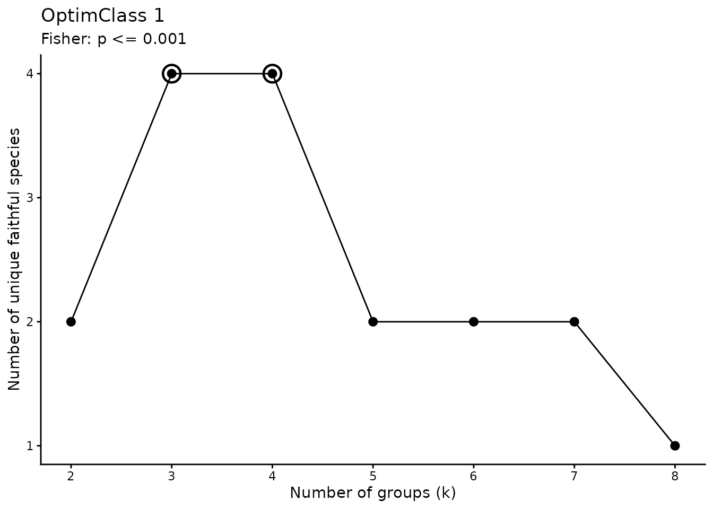
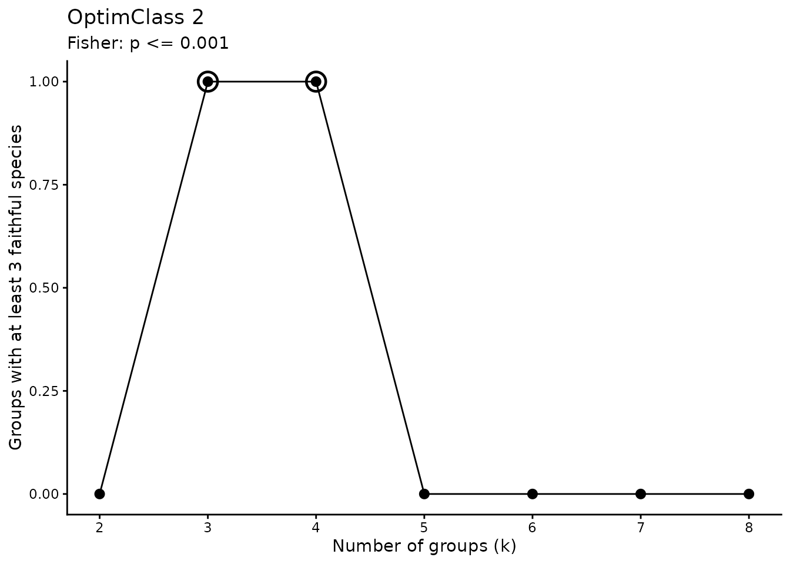
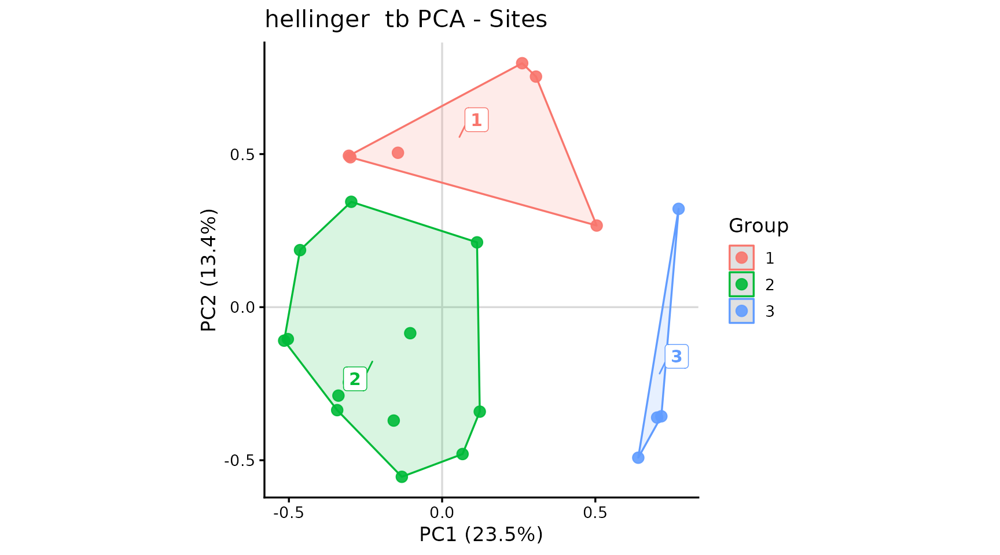
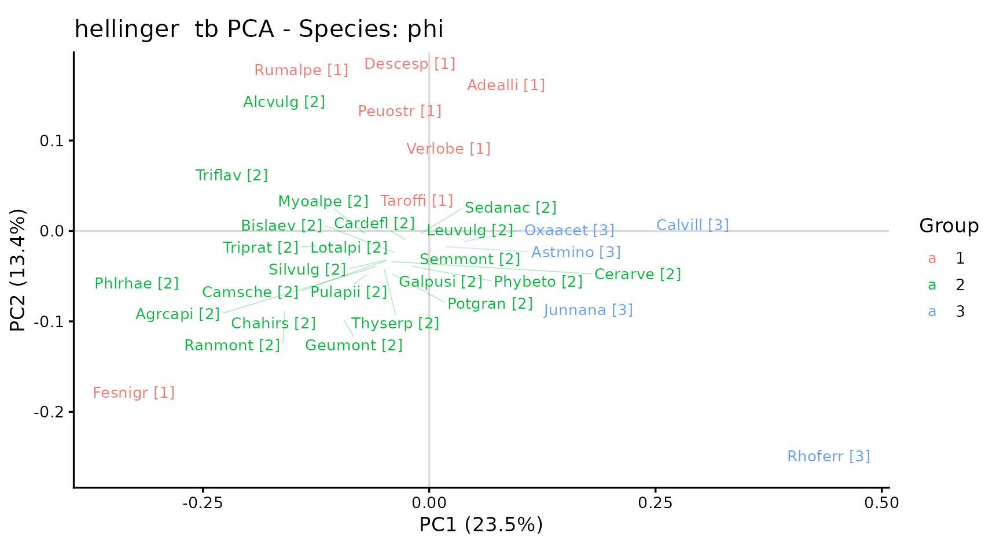

# Vegetation classification: a phytosociological approach

This vignette illustrates classification using modified TWINSPAN and
selection of the number of groups using OptimClass. The resulting groups
are then described using Indicator Species Analysis (ISA), the phi
coefficient, tb-PCA, and a synoptic table.

The example uses only
[`iPastoralist::data`](https://rdrr.io/r/utils/data.html). **For this
example, survey values are assumed to represent percentage cover**,
although the demonstration dataset was originally organised as
frequencies of occurrence. This assumption illustrates the workflow; it
is not a methodological conversion from FO to cover. Real applications
require observed cover values and careful consideration of the
measurement scale.

## 1. Required packages and functions

TWINSPAN requires a version of `ecan` that exports `twinspan()`.

``` r

library(iPastoralist)
library(vegan)
library(indicspecies)
library(permute)
```

## 2. Preparing cover data

``` r

data_example <- as.data.frame(iPastoralist::data)
data_example <- data_example[, c(2, 7:30)]

cover <- iPastoralist::vegetation_abundance(
  database = data_example,
  species.cover.coefficient = 4,
  method = "SC_fo_occ"
)

# Rows = surveys; columns = species.
veg <- t(cover)

dim(veg)
#> [1]  24 152
knitr::kable(veg[seq_len(min(6L, nrow(veg))), seq_len(min(6L, ncol(veg)))])
```

|     | Achmacr | Achmill | Achmosc | Acialpi | Acolama | Adealli |
|:----|--------:|--------:|--------:|--------:|--------:|--------:|
| R1  |       0 |       0 |       0 |       0 |     0.3 |     0.0 |
| R2  |       0 |       0 |       0 |       0 |     0.0 |     0.3 |
| R3  |       0 |       0 |       0 |       0 |     0.0 |     0.0 |
| R4  |       0 |       0 |       0 |       0 |     0.0 |     0.0 |
| R5  |       0 |       0 |       0 |       0 |     0.0 |     0.0 |
| R6  |       0 |       0 |       0 |       0 |     0.0 |     0.0 |

## 3. Modified TWINSPAN and OptimClass

TWINSPAN uses pseudospecies cut levels to represent abundances. Here,
the cover thresholds are `0`, `2`, `5`, `10`, and `20`. Modified
TWINSPAN prioritises splitting the most heterogeneous group. OptimClass
compares partitions based on faithful species: OptimClass 1 considers
the total number of faithful species, whereas OptimClass 2 considers the
number of groups containing a sufficient number of faithful species
([Tichý et al.,
2010](https://doi.org/10.1111/j.1654-1103.2009.01143.x)).

The significance threshold and minimum number of faithful species are
analysis parameters that should be reported and assessed for your
dataset. The range of group numbers examined here is also limited by the
small size of the demonstration dataset.

``` r

min_size <- 2L
k_values <- 2:8
cut_levels <- c(0, 2, 5, 10, 20)
p_threshold <- 1e-3
min_faithful <- 3L
select_by <- "optimclass2" # alternative: "optimclass1"
```

In the `ecan` backend, `min_size` controls which groups can be split
further; on its own, it does not guarantee that every final group
contains at least that many surveys. Always check final group sizes
after classification.

``` r

twinspan_res <- twinspan_optimclass_ecan(
  veg = veg,
  cut_levels = cut_levels,
  min_size = min_size,
  k_values = k_values,
  p_threshold = p_threshold,
  min_faithful = min_faithful,
  version = "fast",
  select_by = select_by,
  show_plots = TRUE
)
```



    #> 
    #> --- TWINSPAN + OPTIMCLASS ---
    #> Version: fast 
    #> OptimClass 1, optimal k values: 3, 4 
    #> OptimClass 2, optimal k values: 3, 4 
    #> Selected partition:3groups (optimclass2)
    #> Unique faithful species: 4

    knitr::kable(twinspan_res$results)

| k | optimclass1 | optimclass2 | prop_good_clusters | min_group_size | best_optim1 | best_optim2 |
|---:|---:|---:|---:|---:|:---|:---|
| 2 | 2 | 0 | 0.0000000 | 4 | FALSE | FALSE |
| 3 | 4 | 1 | 0.3333333 | 4 | TRUE | TRUE |
| 4 | 4 | 1 | 0.2500000 | 3 | TRUE | TRUE |
| 5 | 2 | 0 | 0.0000000 | 3 | FALSE | FALSE |
| 6 | 2 | 0 | 0.0000000 | 3 | FALSE | FALSE |
| 7 | 2 | 0 | 0.0000000 | 1 | FALSE | FALSE |
| 8 | 1 | 0 | 0.0000000 | 1 | FALSE | FALSE |

``` r

twinspan_res$best_k
#> $optimclass1
#> [1] 3 4
#> 
#> $optimclass2
#> [1] 3 4
twinspan_res$selected_k
#> [1] 3
```

Also examine the faithful species of the selected solution. Species used
by OptimClass to select a partition may differ from those subsequently
selected using IndVal or phi: the criteria and thresholds are not
interchangeable.

``` r

twinspan_res$faithful_by_group
#> $G1
#> character(0)
#> 
#> $G2
#> [1] "Cerarve" "Myoalpe" "Phybeto" "Potgran"
#> 
#> $G3
#> character(0)
head(twinspan_res$faithful_species)
#>   k group species      p_value
#> 3 3    G2 Cerarve 1.458249e-04
#> 4 3    G2 Myoalpe 7.189271e-05
#> 5 3    G2 Phybeto 3.701710e-04
#> 6 3    G2 Potgran 5.103872e-04
```

## 4. Selecting the partition and aligning groups

The default solution is the one returned by OptimClass. If no single
valid `selected_k` is returned, examine `results` and `best_k` and
choose a solution explicitly. For example, a maximum OptimClass 2 score
of zero does not demonstrate that the groups meet the desired
faithful-species requirement.

``` r

n.cluster <- twinspan_res$selected_k
groups_raw <- as.data.frame(twinspan_res$classification)
```

To assess an alternative solution, run the following chunk instead of
the previous one. It is excluded from normal rendering with
`eval = FALSE` to avoid automatically overwriting the OptimClass
selection. After running it manually, rerun all subsequent chunks,
starting with group alignment.

``` r

k_custom <- 4L

twin_ecan <- ecan::twinspan(
  x = veg,
  modified = TRUE,
  n_clusters = k_custom,
  cut_levels = cut_levels,
  min_size = min_size,
  max_depth = 6,
  polish = "hill",
  species = FALSE
)

groups_raw <- as.data.frame(twin_ecan$classification[, c("stand", "group")])
n.cluster <- length(unique(groups_raw$group))
if (n.cluster != k_custom) {
  stop("TWINSPAN did not reach the requested number of groups.")
}

# Convert using the ecan S3 method, without calling internal functions.
hc_ecan <- stats::as.hclust(twin_ecan)
plot(hc_ecan, hang = -1, sub = "", main = "TWINSPAN - alternative solution")
```

Retain the partition in `classification`: do not derive a new
classification by applying `cutree()` to the displayed dendrogram.
Recode group labels as `1`, `2`, etc., and store them as a factor with
the same level order for ISA, phi, PCA, and the synoptic table. This
ensures that the version of
[`synoptic_table()`](../reference/synoptic_table.md) that adds a `G`
prefix to frequency columns produces `G1`, `G2`, etc.

``` r

groups <- groups_raw[
  match(rownames(veg), as.character(groups_raw$stand)),
  c("stand", "group"),
  drop = FALSE
]
rownames(groups) <- NULL

# Retain the mapping to the original group labels.
original_group_levels <- levels(factor(groups$group))
group_key <- data.frame(
  original_group = original_group_levels,
  group = seq_along(original_group_levels)
)
groups$group <- factor(
  match(as.character(groups$group), original_group_levels),
  levels = seq_along(original_group_levels)
)

stopifnot(
  identical(rownames(veg), as.character(groups$stand)),
  !anyNA(groups$group),
  nlevels(droplevels(groups$group)) == n.cluster
)

knitr::kable(group_key)
```

| original_group | group |
|:---------------|------:|
| G1             |     1 |
| G2             |     2 |
| G3             |     3 |

``` r

knitr::kable(groups)
```

| stand | group |
|:------|:------|
| R1    | 2     |
| R2    | 1     |
| R3    | 1     |
| R4    | 1     |
| R5    | 2     |
| R6    | 2     |
| R7    | 2     |
| R8    | 2     |
| R9    | 2     |
| R10   | 2     |
| R11   | 2     |
| R12   | 2     |
| R13   | 3     |
| R14   | 1     |
| R15   | 2     |
| R16   | 3     |
| R17   | 1     |
| R18   | 2     |
| R19   | 1     |
| R20   | 2     |
| R21   | 2     |
| R22   | 2     |
| R23   | 3     |
| R24   | 3     |

``` r

table(groups$group)
#> 
#>  1  2  3 
#>  6 14  4
```

## 5. Indicator Species Analysis

Calculate IndVal from cover data, using `func = "IndVal.g"` to account
for unequal group sizes. Setting `duleg = TRUE` searches for species
associated with individual groups, excluding combinations of groups.

The 9999 permutations are shared with the phi analysis. They are
unrestricted in this example; a blocked design or repeated surveys
require constraints consistent with the sampling design.

``` r

set.seed(123)
nperm <- 499L #to be fast here (better 9999)
indval <- indicspecies::multipatt(
  x = veg,
  cluster = groups$group,
  func = "IndVal.g",
  duleg = TRUE,
  permutations = nperm
)

summary(indval, alpha = 0.05, indvalcomp = TRUE)
#> 
#>  Multilevel pattern analysis
#>  ---------------------------
#> 
#>  Association function: IndVal.g
#>  Significance level (alpha): 0.05
#> 
#>  Total number of species: 152
#>  Selected number of species: 34 
#>  Number of species associated to 1 group: 34 
#>  Number of species associated to 2 groups: 0 
#> 
#>  List of species associated to each combination: 
#> 
#>  Group 1  #sps.  7 
#>              A      B  stat p.value   
#> Peuostr 0.9883 0.8333 0.908   0.005 **
#> Rumalpe 0.7240 1.0000 0.851   0.025 * 
#> Adealli 1.0000 0.6667 0.816   0.015 * 
#> Verlobe 0.9955 0.6667 0.815   0.015 * 
#> Luzalpi 0.9571 0.6667 0.799   0.040 * 
#> Descesp 0.9908 0.5000 0.704   0.025 * 
#> Taroffi 0.8750 0.5000 0.661   0.035 * 
#> 
#>  Group 2  #sps.  20 
#>              A      B  stat p.value   
#> Myoalpe 0.9923 0.9286 0.960   0.005 **
#> Chahirs 0.9859 0.9286 0.957   0.005 **
#> Camsche 0.9271 0.9286 0.928   0.015 * 
#> Ranmont 0.9209 0.9286 0.925   0.010 **
#> Fesnigr 0.8458 1.0000 0.920   0.005 **
#> Lotalpi 0.9293 0.8571 0.892   0.015 * 
#> Cerarve 1.0000 0.7857 0.886   0.015 * 
#> Geumont 0.9028 0.8571 0.880   0.010 **
#> Triprat 0.8862 0.8571 0.872   0.020 * 
#> Antalpi 0.8762 0.8571 0.867   0.005 **
#> Phybeto 0.8743 0.8571 0.866   0.050 * 
#> Potgran 1.0000 0.7143 0.845   0.020 * 
#> Silvulg 0.8854 0.7857 0.834   0.035 * 
#> Agrcapi 0.6929 1.0000 0.832   0.010 **
#> Galpusi 1.0000 0.6429 0.802   0.045 * 
#> Pulapii 1.0000 0.6429 0.802   0.035 * 
#> Phlrhae 0.6327 1.0000 0.795   0.015 * 
#> Cardefl 0.9680 0.5714 0.744   0.050 * 
#> Bislaev 1.0000 0.5000 0.707   0.045 * 
#> Leuvulg 1.0000 0.5000 0.707   0.020 * 
#> 
#>  Group 3  #sps.  7 
#>              A      B  stat p.value   
#> Rhoferr 0.8543 1.0000 0.924   0.005 **
#> Junnana 0.9965 0.7500 0.864   0.015 * 
#> Calvill 0.9209 0.7500 0.831   0.015 * 
#> Oxaacet 1.0000 0.5000 0.707   0.030 * 
#> Astmino 0.6632 0.7500 0.705   0.050 * 
#> Arnmont 0.9790 0.5000 0.700   0.025 * 
#> Gymdryo 0.9333 0.5000 0.683   0.035 * 
#> ---
#> Signif. codes:  0 '***' 0.001 '**' 0.01 '*' 0.05 '.' 0.1 ' ' 1
```

The `A.g` component describes indicator specificity, whereas `B`
describes the frequency of the species within the group. The `stat`
value returned by
[`multipatt()`](https://emf-creaf.github.io/indicspecies/reference/multipatt.html)
is the square root of IndVal.

## 6. Phi coefficient

For phi, convert cover values to presence/absence. With `func = "r.g"`,
the association is adjusted for unequal group sizes. Occasional species
with a cover value of 0.3 are therefore considered present.

``` r

veg_pa <- 1L * (veg > 0)

set.seed(123)
phi <- indicspecies::multipatt(
  x = veg_pa,
  cluster = groups$group,
  func = "r.g",
  duleg = TRUE,
  permutations = nperm
)

summary(phi, alpha = 0.05)
#> 
#>  Multilevel pattern analysis
#>  ---------------------------
#> 
#>  Association function: r.g
#>  Significance level (alpha): 0.05
#> 
#>  Total number of species: 152
#>  Selected number of species: 35 
#>  Number of species associated to 1 group: 35 
#>  Number of species associated to 2 groups: 0 
#> 
#>  List of species associated to each combination: 
#> 
#>  Group 1  #sps.  7 
#>          stat p.value   
#> Adealli 0.756   0.005 **
#> Verlobe 0.691   0.035 * 
#> Descesp 0.557   0.030 * 
#> Taroffi 0.557   0.040 * 
#> Rumalpe 0.555   0.015 * 
#> Peuostr 0.553   0.040 * 
#> Fesnigr 0.408   0.015 * 
#> 
#>  Group 2  #sps.  23 
#>          stat p.value   
#> Cerarve 0.842   0.005 **
#> Myoalpe 0.828   0.005 **
#> Potgran 0.791   0.010 **
#> Galpusi 0.739   0.025 * 
#> Pulapii 0.739   0.010 **
#> Phybeto 0.715   0.005 **
#> Geumont 0.665   0.005 **
#> Lotalpi 0.665   0.005 **
#> Triprat 0.665   0.005 **
#> Triflav 0.653   0.005 **
#> Camsche 0.640   0.005 **
#> Ranmont 0.640   0.005 **
#> Bislaev 0.632   0.020 * 
#> Leuvulg 0.632   0.010 **
#> Semmont 0.632   0.025 * 
#> Thyserp 0.632   0.015 * 
#> Silvulg 0.603   0.015 * 
#> Phlrhae 0.564   0.005 **
#> Chahirs 0.562   0.010 **
#> Cardefl 0.534   0.045 * 
#> Sedanac 0.534   0.045 * 
#> Alcvulg 0.500   0.010 **
#> Agrcapi 0.378   0.020 * 
#> 
#>  Group 3  #sps.  5 
#>          stat p.value  
#> Junnana 0.700   0.015 *
#> Calvill 0.633   0.030 *
#> Oxaacet 0.632   0.030 *
#> Rhoferr 0.564   0.045 *
#> Astmino 0.544   0.045 *
#> ---
#> Signif. codes:  0 '***' 0.001 '**' 0.01 '*' 0.05 '.' 0.1 ' ' 1
```

Ubiquitous species may have undefined phi values. Keep the `phi` object
with the species names and order of the original matrix, without
manually reordering or filtering `phi$sign` before building the synoptic
table.

``` r

indval_table <- data.frame(
  species = rownames(indval$sign),
  indval$sign,
  row.names = NULL,
  check.names = FALSE
)
indval_table$group <- levels(groups$group)[indval_table$index]
indval_table$IndVal <- indval_table$stat^2
indval_table$q_BH <- p.adjust(indval_table$p.value, method = "BH")

phi_table <- data.frame(
  species = rownames(phi$sign),
  phi$sign,
  row.names = NULL,
  check.names = FALSE
)
phi_table$group <- levels(groups$group)[phi_table$index]
phi_table$q_BH <- p.adjust(phi_table$p.value, method = "BH")

knitr::kable(head(indval_table[order(indval_table$p.value), ], 10), digits = 3)
```

|     | species | s.1 | s.2 | s.3 | index |  stat | p.value | group | IndVal |  q_BH |
|:----|:--------|----:|----:|----:|------:|------:|--------:|:------|-------:|------:|
| 16  | Antalpi |   0 |   1 |   0 |     2 | 0.867 |   0.005 | 2     |  0.751 | 0.126 |
| 39  | Chahirs |   0 |   1 |   0 |     2 | 0.957 |   0.005 | 2     |  0.916 | 0.126 |
| 56  | Fesnigr |   0 |   1 |   0 |     2 | 0.920 |   0.005 | 2     |  0.846 | 0.126 |
| 86  | Myoalpe |   0 |   1 |   0 |     2 | 0.960 |   0.005 | 2     |  0.921 | 0.126 |
| 91  | Peuostr |   1 |   0 |   0 |     1 | 0.908 |   0.005 | 1     |  0.824 | 0.126 |
| 109 | Rhoferr |   0 |   0 |   1 |     3 | 0.924 |   0.005 | 3     |  0.854 | 0.126 |
| 7   | Agrcapi |   0 |   1 |   0 |     2 | 0.832 |   0.010 | 2     |  0.693 | 0.133 |
| 66  | Geumont |   0 |   1 |   0 |     2 | 0.880 |   0.010 | 2     |  0.774 | 0.133 |
| 106 | Ranmont |   0 |   1 |   0 |     2 | 0.925 |   0.010 | 2     |  0.855 | 0.133 |
| 6   | Adealli |   1 |   0 |   0 |     1 | 0.816 |   0.015 | 1     |  0.667 | 0.133 |

``` r

knitr::kable(head(phi_table[order(phi_table$p.value), ], 10), digits = 3)
```

|     | species | s.1 | s.2 | s.3 | index |  stat | p.value | group |  q_BH |
|:----|:--------|----:|----:|----:|------:|------:|--------:|:------|------:|
| 6   | Adealli |   1 |   0 |   0 |     1 | 0.756 |   0.005 | 1     | 0.069 |
| 25  | Camsche |   0 |   1 |   0 |     2 | 0.640 |   0.005 | 2     | 0.069 |
| 37  | Cerarve |   0 |   1 |   0 |     2 | 0.842 |   0.005 | 2     | 0.069 |
| 66  | Geumont |   0 |   1 |   0 |     2 | 0.665 |   0.005 | 2     | 0.069 |
| 81  | Lotalpi |   0 |   1 |   0 |     2 | 0.665 |   0.005 | 2     | 0.069 |
| 86  | Myoalpe |   0 |   1 |   0 |     2 | 0.828 |   0.005 | 2     | 0.069 |
| 93  | Phlrhae |   0 |   1 |   0 |     2 | 0.564 |   0.005 | 2     | 0.069 |
| 94  | Phybeto |   0 |   1 |   0 |     2 | 0.715 |   0.005 | 2     | 0.069 |
| 106 | Ranmont |   0 |   1 |   0 |     2 | 0.640 |   0.005 | 2     | 0.069 |
| 141 | Triprat |   0 |   1 |   0 |     2 | 0.665 |   0.005 | 2     | 0.069 |

The `q_BH` columns provide a separate Benjamini-Hochberg adjustment for
each index. The summaries, tb-PCA, and synoptic table in this example
follow the interfaces of the functions illustrated and use unadjusted
p-values with `alpha = 0.05`. Keep this distinction explicit when
describing the method.

Because groups are derived from the same data, ISA and phi provide an
exploratory characterisation of the classification, rather than
independent validation or automatic assignment to phytosociological
associations.

## 7. tb-PCA

Compute PCA on Hellinger-transformed cover data. The transformation
applies only to the ordination: `veg` retains the original cover values
for classification, ISA, and the synoptic table. Display species
selected using phi at `alpha = 0.05`.

``` r

pca <- tb_pca_plot(
  veg = veg,
  groups = groups,
  transformation = "hellinger", # alternative: "chord"
  axes = c(1, 2),
  area = "hull", # "hull", "ellipse", or "none"
  indval = indval,
  phi = phi,
  alpha = 0.05,
  species = "phi", # "indval" or "ordiselect"
  ablim = 0.3,
  fitlim = 0.8,
  freq = FALSE,
  label_groups = TRUE,
  segment.alpha_labelSpe = 0.3,
  segment.size_labelSpe = 0.3
)

pca$plot_sites
```



``` r

pca$plot_species
```



Convex hulls describe the distribution of surveys in the ordination
plane and are not confidence intervals. Interpret the plots alongside
the variance explained by the axes and the composition of the groups.

``` r

pca$variance
#>       PC1       PC2       PC3       PC4       PC5       PC6       PC7       PC8 
#> 23.488587 13.406154  9.954948  8.380961  6.260246  5.039406  4.712287  4.323490 
#>       PC9      PC10      PC11      PC12      PC13      PC14      PC15      PC16 
#>  3.515914  3.068504  2.780572  2.386132  2.187248  1.913238  1.723395  1.681543 
#>      PC17      PC18      PC19      PC20      PC21      PC22      PC23 
#>  1.246019  0.935621  0.771616  0.731182  0.642876  0.484845  0.365215
head(pca$sites)
#>    stand          x           y group
#> R1    R1 -0.1314824 -0.55416009     2
#> R2    R2 -0.1442085  0.50428595     1
#> R3    R3 -0.2994681  0.48959336     1
#> R4    R4 -0.3041198  0.49455601     1
#> R5    R5 -0.5034762 -0.10429268     2
#> R6    R6 -0.1040882 -0.08507569     2
head(pca$species)
#>         species           x           y group
#> Adealli Adealli  0.05351652  0.14810718     1
#> Agrcapi Agrcapi -0.05776389 -0.03908370     2
#> Alcvulg Alcvulg -0.18558879  0.12936321     2
#> Astmino Astmino  0.01702381 -0.01739060     3
#> Bislaev Bislaev -0.03698051 -0.02450444     2
#> Calvill Calvill  0.26594510  0.02080365     3
pca$selected_species
#>  [1] "Adealli" "Agrcapi" "Alcvulg" "Astmino" "Bislaev" "Calvill" "Camsche"
#>  [8] "Cardefl" "Cerarve" "Chahirs" "Descesp" "Fesnigr" "Galpusi" "Geumont"
#> [15] "Junnana" "Leuvulg" "Lotalpi" "Myoalpe" "Oxaacet" "Peuostr" "Phlrhae"
#> [22] "Phybeto" "Potgran" "Pulapii" "Ranmont" "Rhoferr" "Rumalpe" "Sedanac"
#> [29] "Semmont" "Silvulg" "Taroffi" "Thyserp" "Triprat" "Triflav" "Verlobe"
```

## 8. Synoptic table

Build the synoptic table from the **original cover values** and the
partition already used for ISA, phi, and PCA. The operational
definitions in this example are:

- diagnostic: phi of at least 0.25 and an unadjusted p-value no greater
  than 0.05;
- constant: present in at least 40% of surveys within the group;
- dominant: cover of at least 25% in at least 50% of surveys within the
  group.

The last definition corresponds to
`dominance_rule = "high_cover_frequency"`. It does not simply mean a
mean cover of at least 25% within the group. The three categories may
overlap.

``` r

stopifnot(
  identical(rownames(phi$sign), colnames(veg)),
  identical(as.character(phi$cluster), as.character(groups$group))
)

tab_sinottica <- synoptic_table(
  veg = veg,
  groups = groups$group,
  phi = phi,
  alpha = 0.05,
  phi_min = 0.25,
  constancy_min = 40,
  dominant_freq_min = 50,
  dominant_cover_min = 25,
  include = c("diagnostic", "constant", "dominant"),
  dominance_rule = "high_cover_frequency"
)

knitr::kable(head(tab_sinottica$synoptic, 20))
```

| group | species | diagnostic | phi | p.value | frequency | constant | high_cover_frequency | max_cover | dominant | G1 | G2 | G3 |
|:---|:---|:---|---:|---:|---:|:---|---:|---:|:---|---:|---:|---:|
| 1 | Rumalpe | TRUE | 0.555 | 0.015 | 100.0 | TRUE | 16.7 | 64.0 | FALSE | 100.0 | 85.7 | 0 |
| 1 | Fesnigr | TRUE | 0.408 | 0.015 | 100.0 | TRUE | 16.7 | 32.0 | FALSE | 100.0 | 100.0 | 25 |
| 1 | Peuostr | TRUE | 0.553 | 0.040 | 83.3 | TRUE | 16.7 | 48.0 | FALSE | 83.3 | 50.0 | 0 |
| 1 | Adealli | TRUE | 0.756 | 0.005 | 66.7 | TRUE | 16.7 | 32.0 | FALSE | 66.7 | 0.0 | 0 |
| 1 | Verlobe | TRUE | 0.691 | 0.035 | 66.7 | TRUE | 0.0 | 20.0 | FALSE | 66.7 | 7.1 | 0 |
| 1 | Descesp | TRUE | 0.557 | 0.030 | 50.0 | TRUE | 33.3 | 92.0 | FALSE | 50.0 | 7.1 | 0 |
| 1 | Taroffi | TRUE | 0.557 | 0.040 | 50.0 | TRUE | 0.0 | 0.3 | FALSE | 50.0 | 7.1 | 0 |
| 1 | Alcvulg | FALSE | NA | NA | 100.0 | TRUE | 0.0 | 24.0 | FALSE | 100.0 | 100.0 | 0 |
| 1 | Agrcapi | FALSE | NA | NA | 83.3 | TRUE | 16.7 | 28.0 | FALSE | 83.3 | 100.0 | 50 |
| 1 | Phlrhae | FALSE | NA | NA | 83.3 | TRUE | 33.3 | 44.0 | FALSE | 83.3 | 100.0 | 0 |
| 1 | Poaalpi | FALSE | NA | NA | 83.3 | TRUE | 0.0 | 16.0 | FALSE | 83.3 | 71.4 | 0 |
| 1 | Antalpi | FALSE | NA | NA | 66.7 | TRUE | 0.0 | 4.0 | FALSE | 66.7 | 85.7 | 25 |
| 1 | Chahirs | FALSE | NA | NA | 66.7 | TRUE | 0.0 | 0.3 | FALSE | 66.7 | 92.9 | 0 |
| 1 | Luzalpi | FALSE | NA | NA | 66.7 | TRUE | 0.0 | 4.0 | FALSE | 66.7 | 21.4 | 0 |
| 1 | Viobifl | FALSE | NA | NA | 66.7 | TRUE | 0.0 | 20.0 | FALSE | 66.7 | 57.1 | 0 |
| 1 | Alnviri | FALSE | NA | NA | 50.0 | TRUE | 33.3 | 92.0 | FALSE | 50.0 | 7.1 | 25 |
| 1 | Camsche | FALSE | NA | NA | 50.0 | TRUE | 0.0 | 0.3 | FALSE | 50.0 | 92.9 | 0 |
| 1 | Cervulg | FALSE | NA | NA | 50.0 | TRUE | 0.0 | 0.3 | FALSE | 50.0 | 21.4 | 0 |
| 1 | Gersylv | FALSE | NA | NA | 50.0 | TRUE | 0.0 | 4.0 | FALSE | 50.0 | 57.1 | 0 |
| 1 | Ranmont | FALSE | NA | NA | 50.0 | TRUE | 0.0 | 4.0 | FALSE | 50.0 | 92.9 | 0 |

With `duleg = TRUE`,
[`multipatt()`](https://emf-creaf.github.io/indicspecies/reference/multipatt.html)
returns the single group with the strongest association for each
species. The synoptic table uses that selection for diagnostic species;
it does not list all possible species-by-group comparisons. A species
may nevertheless be constant or dominant in several groups.

The main table is in long format: a species may appear in multiple rows,
one for each group in which it meets the requested category criteria.
The `frequency` matrix includes all species and reports their percentage
frequencies within groups.

``` r

# Diagnostic species only.
diagnostic_species <- subset(tab_sinottica$synoptic, diagnostic)
knitr::kable(head(diagnostic_species, 20))
```

|  | group | species | diagnostic | phi | p.value | frequency | constant | high_cover_frequency | max_cover | dominant | G1 | G2 | G3 |
|:---|:---|:---|:---|---:|---:|---:|:---|---:|---:|:---|---:|---:|---:|
| 1 | 1 | Rumalpe | TRUE | 0.555 | 0.015 | 100.0 | TRUE | 16.7 | 64.0 | FALSE | 100.0 | 85.7 | 0 |
| 2 | 1 | Fesnigr | TRUE | 0.408 | 0.015 | 100.0 | TRUE | 16.7 | 32.0 | FALSE | 100.0 | 100.0 | 25 |
| 3 | 1 | Peuostr | TRUE | 0.553 | 0.040 | 83.3 | TRUE | 16.7 | 48.0 | FALSE | 83.3 | 50.0 | 0 |
| 4 | 1 | Adealli | TRUE | 0.756 | 0.005 | 66.7 | TRUE | 16.7 | 32.0 | FALSE | 66.7 | 0.0 | 0 |
| 5 | 1 | Verlobe | TRUE | 0.691 | 0.035 | 66.7 | TRUE | 0.0 | 20.0 | FALSE | 66.7 | 7.1 | 0 |
| 6 | 1 | Descesp | TRUE | 0.557 | 0.030 | 50.0 | TRUE | 33.3 | 92.0 | FALSE | 50.0 | 7.1 | 0 |
| 7 | 1 | Taroffi | TRUE | 0.557 | 0.040 | 50.0 | TRUE | 0.0 | 0.3 | FALSE | 50.0 | 7.1 | 0 |
| 23 | 2 | Phlrhae | TRUE | 0.564 | 0.005 | 100.0 | TRUE | 35.7 | 44.0 | FALSE | 83.3 | 100.0 | 0 |
| 24 | 2 | Alcvulg | TRUE | 0.500 | 0.010 | 100.0 | TRUE | 7.1 | 72.0 | FALSE | 100.0 | 100.0 | 0 |
| 25 | 2 | Agrcapi | TRUE | 0.378 | 0.020 | 100.0 | TRUE | 21.4 | 60.0 | FALSE | 83.3 | 100.0 | 50 |
| 26 | 2 | Myoalpe | TRUE | 0.828 | 0.005 | 92.9 | TRUE | 7.1 | 40.0 | FALSE | 16.7 | 92.9 | 0 |
| 27 | 2 | Camsche | TRUE | 0.640 | 0.005 | 92.9 | TRUE | 0.0 | 8.0 | FALSE | 50.0 | 92.9 | 0 |
| 28 | 2 | Ranmont | TRUE | 0.640 | 0.005 | 92.9 | TRUE | 14.3 | 36.0 | FALSE | 50.0 | 92.9 | 0 |
| 29 | 2 | Chahirs | TRUE | 0.562 | 0.010 | 92.9 | TRUE | 7.1 | 28.0 | FALSE | 66.7 | 92.9 | 0 |
| 30 | 2 | Phybeto | TRUE | 0.715 | 0.005 | 85.7 | TRUE | 0.0 | 4.0 | FALSE | 0.0 | 85.7 | 25 |
| 31 | 2 | Geumont | TRUE | 0.665 | 0.005 | 85.7 | TRUE | 0.0 | 24.0 | FALSE | 33.3 | 85.7 | 0 |
| 32 | 2 | Lotalpi | TRUE | 0.665 | 0.005 | 85.7 | TRUE | 0.0 | 4.0 | FALSE | 33.3 | 85.7 | 0 |
| 33 | 2 | Triprat | TRUE | 0.665 | 0.005 | 85.7 | TRUE | 0.0 | 24.0 | FALSE | 33.3 | 85.7 | 0 |
| 34 | 2 | Cerarve | TRUE | 0.842 | 0.005 | 78.6 | TRUE | 0.0 | 8.0 | FALSE | 0.0 | 78.6 | 0 |
| 35 | 2 | Silvulg | TRUE | 0.603 | 0.015 | 78.6 | TRUE | 7.1 | 28.0 | FALSE | 33.3 | 78.6 | 0 |

``` r


# Diagnostic or constant species in group 2.
group2_species <- subset(
  tab_sinottica$synoptic,
  (diagnostic | constant) & as.character(group) == "2"
)
knitr::kable(head(group2_species, 20))
```

|  | group | species | diagnostic | phi | p.value | frequency | constant | high_cover_frequency | max_cover | dominant | G1 | G2 | G3 |
|:---|:---|:---|:---|---:|---:|---:|:---|---:|---:|:---|---:|---:|---:|
| 23 | 2 | Phlrhae | TRUE | 0.564 | 0.005 | 100.0 | TRUE | 35.7 | 44 | FALSE | 83.3 | 100.0 | 0 |
| 24 | 2 | Alcvulg | TRUE | 0.500 | 0.010 | 100.0 | TRUE | 7.1 | 72 | FALSE | 100.0 | 100.0 | 0 |
| 25 | 2 | Agrcapi | TRUE | 0.378 | 0.020 | 100.0 | TRUE | 21.4 | 60 | FALSE | 83.3 | 100.0 | 50 |
| 26 | 2 | Myoalpe | TRUE | 0.828 | 0.005 | 92.9 | TRUE | 7.1 | 40 | FALSE | 16.7 | 92.9 | 0 |
| 27 | 2 | Camsche | TRUE | 0.640 | 0.005 | 92.9 | TRUE | 0.0 | 8 | FALSE | 50.0 | 92.9 | 0 |
| 28 | 2 | Ranmont | TRUE | 0.640 | 0.005 | 92.9 | TRUE | 14.3 | 36 | FALSE | 50.0 | 92.9 | 0 |
| 29 | 2 | Chahirs | TRUE | 0.562 | 0.010 | 92.9 | TRUE | 7.1 | 28 | FALSE | 66.7 | 92.9 | 0 |
| 30 | 2 | Phybeto | TRUE | 0.715 | 0.005 | 85.7 | TRUE | 0.0 | 4 | FALSE | 0.0 | 85.7 | 25 |
| 31 | 2 | Geumont | TRUE | 0.665 | 0.005 | 85.7 | TRUE | 0.0 | 24 | FALSE | 33.3 | 85.7 | 0 |
| 32 | 2 | Lotalpi | TRUE | 0.665 | 0.005 | 85.7 | TRUE | 0.0 | 4 | FALSE | 33.3 | 85.7 | 0 |
| 33 | 2 | Triprat | TRUE | 0.665 | 0.005 | 85.7 | TRUE | 0.0 | 24 | FALSE | 33.3 | 85.7 | 0 |
| 34 | 2 | Cerarve | TRUE | 0.842 | 0.005 | 78.6 | TRUE | 0.0 | 8 | FALSE | 0.0 | 78.6 | 0 |
| 35 | 2 | Silvulg | TRUE | 0.603 | 0.015 | 78.6 | TRUE | 7.1 | 28 | FALSE | 33.3 | 78.6 | 0 |
| 36 | 2 | Potgran | TRUE | 0.791 | 0.010 | 71.4 | TRUE | 0.0 | 8 | FALSE | 0.0 | 71.4 | 0 |
| 37 | 2 | Triflav | TRUE | 0.653 | 0.005 | 71.4 | TRUE | 28.6 | 36 | FALSE | 16.7 | 71.4 | 0 |
| 38 | 2 | Galpusi | TRUE | 0.739 | 0.025 | 64.3 | TRUE | 0.0 | 8 | FALSE | 0.0 | 64.3 | 0 |
| 39 | 2 | Pulapii | TRUE | 0.739 | 0.010 | 64.3 | TRUE | 0.0 | 24 | FALSE | 0.0 | 64.3 | 0 |
| 40 | 2 | Cardefl | TRUE | 0.534 | 0.045 | 57.1 | TRUE | 0.0 | 8 | FALSE | 16.7 | 57.1 | 0 |
| 41 | 2 | Sedanac | TRUE | 0.534 | 0.045 | 57.1 | TRUE | 0.0 | 4 | FALSE | 16.7 | 57.1 | 0 |
| 42 | 2 | Bislaev | TRUE | 0.632 | 0.020 | 50.0 | TRUE | 0.0 | 12 | FALSE | 0.0 | 50.0 | 0 |

``` r


# Percentage frequencies of all species.
head(tab_sinottica$frequency)
#>               G1        G2 G3
#> Achmacr 33.33333  0.000000  0
#> Achmill  0.00000 42.857143  0
#> Achmosc  0.00000 14.285714  0
#> Acialpi  0.00000 28.571429  0
#> Acolama 33.33333  7.142857  0
#> Adealli 66.66667  0.000000  0

# Diagnostic species and their associations.
head(tab_sinottica$diagnostic)
#>   species diagnostic diagnostic_group       phi p.value
#> 1 Adealli       TRUE                1 0.7559289   0.005
#> 2 Agrcapi       TRUE                2 0.3779645   0.020
#> 3 Alcvulg       TRUE                2 0.5000000   0.010
#> 4 Astmino       TRUE                3 0.5442535   0.045
#> 5 Bislaev       TRUE                2 0.6324555   0.020
#> 6 Calvill       TRUE                3 0.6328612   0.030
```

## 9. Optional export

The first chunk saves results and frequencies using base R functions.
Both export chunks are excluded from normal rendering.

``` r

output_dir <- "risultati_fitosociologia"
dir.create(output_dir, recursive = TRUE, showWarnings = FALSE)

write.csv2(groups, file.path(output_dir, "gruppi.csv"), row.names = FALSE)
write.csv2(
  group_key,
  file.path(output_dir, "corrispondenza_gruppi.csv"),
  row.names = FALSE
)
write.csv2(
  twinspan_res$results,
  file.path(output_dir, "optimclass.csv"),
  row.names = FALSE
)
write.csv2(indval_table, file.path(output_dir, "indval.csv"), row.names = FALSE)
write.csv2(phi_table, file.path(output_dir, "phi.csv"), row.names = FALSE)
write.csv2(
  tab_sinottica$synoptic,
  file.path(output_dir, "sinottica_lunga.csv"),
  row.names = FALSE
)

frequency_table <- data.frame(
  species = rownames(tab_sinottica$frequency),
  tab_sinottica$frequency,
  row.names = NULL,
  check.names = FALSE
)
write.csv2(
  frequency_table,
  file.path(output_dir, "frequenze.csv"),
  row.names = FALSE
)

saveRDS(
  list(
    veg = veg,
    optimclass = twinspan_res,
    n.cluster = n.cluster,
    groups = groups,
    group_key = group_key,
    indval = indval,
    phi = phi,
    pca = pca,
    synoptic = tab_sinottica,
    permutations = permutation_matrix,
    parameters = list(
      cut_levels = cut_levels,
      min_size = min_size,
      k_values = k_values,
      p_threshold = p_threshold,
      min_faithful = min_faithful,
      select_by = select_by,
      occasional_cover = occasional_cover
    ),
    session = sessionInfo()
  ),
  file.path(output_dir, "analisi_fitosociologica.rds")
)
```

If [`export_synoptic()`](../reference/export_synoptic.md) is also
available, export an abbreviated synoptic table to Excel. In the
interface used here, `min_frequency = 30` retains all diagnostic species
and, among the other species in the input synoptic table, those with a
frequency of at least 30% in one group. It does not restore species
already excluded by `include` when building the table.

``` r

stopifnot(exists("export_synoptic", mode = "function"))

export_synoptic(
  tab_sinottica$synoptic,
  file = "Sinottica_short.xlsx",
  min_frequency = 30,
  digits = 1,
  group_sizes = table(groups$group)
)
```

## Function references

- [iPastoralist documentation and source
  code](https://github.com/MarcoPittarello/iPastoralist).
- [TWINSPAN in the ecan
  package](https://matutosi.github.io/ecan/reference/twinspan.html).
- [OptimClass: Tichý et
  al. (2010)](https://doi.org/10.1111/j.1654-1103.2009.01143.x).
- [multipatt
  documentation](https://search.r-project.org/CRAN/refmans/indicspecies/html/multipatt.html).
