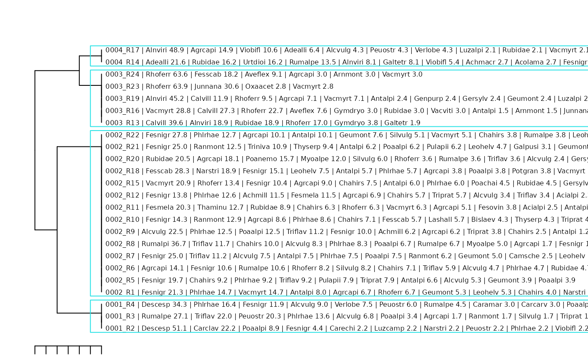

# TUTORIAL_4_Quick_classification_and_interpretation

The `iPastoralist` wrappers provide an optional shortcut for inspecting
vegetation groups together with the ten most abundant species beside
each survey. This can help reveal changes in species composition along
the dendrogram and give each group an initial ecological interpretation.

Two functions are available:
[`plotClustAggregate_twspn()`](https://marcopittarello.github.io/iPastoralist/reference/plotClustAggregate_twspn.md)
for a TWINSPAN classification, illustrated here with phytosociological
cover data, and
[`plotClustAggregate()`](https://marcopittarello.github.io/iPastoralist/reference/plotClustAggregate.md)
for agglomerative clustering, illustrated with point-quadrat data.

With `aggregate = TRUE`, both functions retain individual surveys as
leaves, prefix their labels with group identifiers, draw rectangles
around groups, and return a table describing group composition. Here,
aggregation refers to the group summaries; surveys remain visible in the
dendrogram.

## Before running the examples

These examples complement the phytosociological and pastoral
classification vignettes. Run each section after preparing the inputs in
the corresponding workflow. The code is shown without automatic
execution because it uses those existing objects and includes file
export.

Use a version of `iPastoralist` containing the wrappers and their helper
functions. The TWINSPAN wrapper also requires
[`ecan::twinspan()`](https://matutosi.github.io/ecan/reference/twinspan.html).

``` r

library(iPastoralist)
#> Registered S3 method overwritten by 'vegan':
#>   method     from      
#>   rev.hclust dendextend

data_example <- as.data.frame(iPastoralist::data)
vegetation <- data_example[, c(2, 7:ncol(data_example))]
sra <- vegetation_abundance(
  database = vegetation,
  method = "SRA_fo"
)
# For subsequent analyses: rows = surveys; columns = species.
veg <- t(as.matrix(sra))
```

In both sections, `veg` is a numeric matrix with **surveys in rows and
species in columns**, with unique survey and species names. Its meaning
depends on the workflow: percentage cover for phytosociological surveys
and SRA for the point-quadrat example. The object `n.cluster` is the
chosen number of groups.

Two arguments control how many species are reported:

| Argument | Meaning | Value used here |
|:---|:---|:---|
| `nspePlot` | Species appended to each survey label, ranked by abundance within that survey | `10` |
| `aggr.Nspe` | Species reported for each group, ranked by mean abundance across its surveys | `10` |

The first ten species beside a survey and the first ten species in a
group summary describe different levels of the data. Both settings can
be reduced independently when shorter labels or summaries are useful.

## Phytosociological surveys: TWINSPAN

``` r

phyto_groups <- plotClustAggregate_twspn(
  dbClust = veg,
  nspePlot = 10,
  aggregate = TRUE,
  aggr.Nspe = 3,
  modified = TRUE,
  n_clusters = 4,
  cut_levels = c(1, 2, 2, 40),
  min_size = 2,
  max_depth = 6,
  polish = "hill",
  species = FALSE,
  labels.cex = 0.5,
  clust.mar = c(1, 2, 2, 30),
  save.file = FALSE,
  display = TRUE
)
```



``` r


knitr::kable(phyto_groups)
```

| group | name                                        |
|------:|:--------------------------------------------|
|     1 | Descesp (28%), Phlrhae (11%), Rumalpe (11%) |
|     2 | Fesnigr (14%), Phlrhae (8%), Agrcapi (7%)   |
|     3 | Rhoferr (35%), Calvill (16%), Alnviri (13%) |
|     4 | Alnviri (29%), Adealli (14%), Rubidae (9%)  |

``` r

# Actual number of groups and survey membership in dendrogram order.
attr(phyto_groups, "n.clusters")
#> [1] 4
attr(phyto_groups, "survey.order")
#>    Survey cluster Survey.order path depth
#> 1      R2       1            1   00     2
#> 2      R3       1            2   00     2
#> 3      R4       1            3   00     2
#> 4      R1       2            4   01     2
#> 5      R5       2            5   01     2
#> 6      R6       2            6   01     2
#> 7      R7       2            7   01     2
#> 8      R8       2            8   01     2
#> 9      R9       2            9   01     2
#> 10    R10       2           10   01     2
#> 11    R11       2           11   01     2
#> 12    R12       2           12   01     2
#> 13    R15       2           13   01     2
#> 14    R18       2           14   01     2
#> 15    R20       2           15   01     2
#> 16    R21       2           16   01     2
#> 17    R22       2           17   01     2
#> 18    R13       3           18   10     2
#> 19    R16       3           19   10     2
#> 20    R19       3           20   10     2
#> 21    R23       3           21   10     2
#> 22    R24       3           22   10     2
#> 23    R14       4           23   11     2
#> 24    R17       4           24   11     2

# Mean species cover within each group, including absences as zeros.
attr(phyto_groups, "mean.abundance")
#>    Achmacr  Achmill Achmosc   Acialpi  Acolama Adealli  Agrcapi Ajupyra Alcalpi
#> 1 0.000000 0.000000       0 0.0000000 0.000000  0.0000 1.062484       0       0
#> 2 0.000000 1.267447       0 0.3450354 0.000000  0.0000 6.640888       0       0
#> 3 0.000000 0.000000       0 0.0000000 0.000000  0.0000 2.034632       0       0
#> 4 1.351351 0.000000       0 0.0000000 1.351351 14.0023 7.446809       0       0
#>      Alcpent  Alcvulg  Alnviri Angsylv Antdioi Antvuln   Antalpi Araalpi
#> 1 0.00000000 5.244962  0.00000       0       0       0 0.0000000       0
#> 2 0.08928571 3.868592  0.00000       0       0       0 4.3660383       0
#> 3 0.00000000 0.000000 12.82120       0       0       0 0.7792208       0
#> 4 0.00000000 2.127660 28.52214       0       0       0 0.0000000       0
#>   Aracili   Arnmont Astmino   Aveflex   Bislaev Botluna  Calvill   Camsche
#> 1       0 0.0000000       0 0.0000000 0.0000000       0  0.00000 0.0000000
#> 2       0 0.0000000       0 0.3086329 0.3882243       0  0.00000 0.5534839
#> 3       0 0.9090909       0 3.3333333 0.0000000       0 15.76003 0.0000000
#> 4       0 0.0000000       0 0.0000000 0.0000000       0  0.00000 0.0000000
#>   Capburs   Caramar Carrese   Cardefl  Carclav   Carechi Carorni Carpall
#> 1       0 0.9950249       0 0.0000000 7.407407 0.7407407       0       0
#> 2       0 0.0000000       0 0.4582169 0.000000 0.0000000       0       0
#> 3       0 0.0000000       0 0.0000000 0.000000 0.0000000       0       0
#> 4       0 0.0000000       0 0.0000000 0.000000 0.0000000       0       0
#>     Carsemp   Carcarv Cennerv   Cerarve   Cervulg  Chahirs Chebonu Coeviri
#> 1 0.0000000 0.9950249       0 0.0000000 0.0000000 0.000000       0       0
#> 2 0.2287559 0.0000000       0 0.4555124 0.1785714 4.693102       0       0
#> 3 0.0000000 0.0000000       0 0.0000000 0.0000000 0.000000       0       0
#> 4 0.0000000 0.0000000       0 0.0000000 0.0000000 0.000000       0       0
#>   Croalbi Crycris   Cusepit   Dapmeze     Descesp Dryaffi Epialpe Epiangu
#> 1       0       0 0.0000000 0.0000000 28.47982311       0       0       0
#> 2       0       0 0.0952381 0.1066098  0.08928571       0       0       0
#> 3       0       0 0.0000000 0.0000000  0.00000000       0       0       0
#> 4       0       0 0.0000000 0.0000000  0.00000000       0       0       0
#>   Epicoll Erialpi   Eupcypa Eupmini   Fesovin  Fesmela   Fesnigr  Fesscab
#> 1       0       0 0.0000000       0 0.0000000 0.000000  5.461581 0.000000
#> 2       0       0 0.3805561       0 0.2712477 2.369713 14.004280 2.694592
#> 3       0       0 0.0000000       0 0.0000000 0.000000  0.000000 3.636364
#> 4       0       0 0.0000000       0 0.0000000 0.000000  1.351351 0.000000
#>   Foualpi Gallada   Galtetr   Galpusi Genacau   Genpurp Genramo   Gersylv
#> 1       0       0 0.0000000 0.0000000       0 0.0000000       0 0.0000000
#> 2       0       0 0.3231293 0.3874179       0 0.0000000       0 0.5534039
#> 3       0       0 0.3773585 0.0000000       0 0.4761905       0 0.4761905
#> 4       0       0 4.0540541 0.0000000       0 0.0000000       0 0.0000000
#>     Geumont    Geuriva    Gymdryo Hielact Hievill    Hiemuro Hipcomo Homalpi
#> 1 0.0000000 0.00000000 0.00000000       0       0 0.00000000       0       0
#> 2 2.1651149 0.08605852 0.08403361       0       0 0.09041591       0       0
#> 3 0.4761905 0.00000000 1.36077759       0       0 0.00000000       0       0
#> 4 0.0000000 0.00000000 0.00000000       0       0 0.00000000       0       0
#>   Junmona  Junnana Lardeci   Lashall  Leohelv Leuvulg Lilmart   Lotalpi
#> 1       0 0.000000       0 0.0000000 0.000000       0       0 0.0000000
#> 2       0 0.000000       0 0.4081633 1.614261       0       0 0.4095435
#> 3       0 6.414141       0 0.0000000 0.000000       0       0 0.0000000
#> 4       0 0.000000       0 0.0000000 0.000000       0       0 0.0000000
#>     Luzalpi   Luzcamp   Luzsylv Molarun  Myoalpe   Narstri   Oxaacet Parlili
#> 1 0.0000000 0.7407407 0.0000000       0 0.000000 0.7407407 0.0000000       0
#> 2 0.0000000 0.0000000 0.0000000       0 2.041705 1.7190169 0.0000000       0
#> 3 0.4761905 0.0000000 0.4761905       0 0.000000 0.0000000 0.5555556       0
#> 4 1.0638298 0.0000000 0.0000000       0 0.000000 0.0000000 0.0000000       0
#>   Pedtube  Peuostr Pheconn   Phlrhae   Phybeto Phyhemi   Poaalpi   Poachai
#> 1       0 9.510452       0 10.733152 0.0000000       0 5.0879313 0.0000000
#> 2       0 0.000000       0  7.694231 0.0952381       0 3.1656208 0.6521003
#> 3       0 0.000000       0  0.000000 0.0000000       0 0.4761905 0.0000000
#> 4       0 2.127660       0  0.000000 0.0000000       0 0.0000000 0.0000000
#>    Poanemo   Poaprat    Pollonc Potaure   Potgran Prihirs Psealbi  Pulapii
#> 1 0.000000 0.0000000 0.00000000       0 0.0000000       0       0 0.000000
#> 2 1.413258 0.2011494 0.08605852       0 0.6580243       0       0 1.200982
#> 3 0.000000 0.0000000 0.00000000       0 0.0000000       0       0 0.000000
#> 4 0.000000 0.0000000 0.00000000       0 0.0000000       0       0 0.000000
#>     Ranmont   Rhialec Rhorose   Rhoferr Rospend  Rubidae    Rumalpe  Rumalpi
#> 1 0.5649718 0.0000000       0  0.000000       0 0.000000 10.5320853 0.000000
#> 2 3.0901061 0.3792965       0  2.898373       0 2.751870  2.0517968 2.619048
#> 3 0.0000000 0.0000000       0 35.351493       0 4.379646  0.4761905 0.000000
#> 4 0.0000000 0.0000000       0  0.000000       0 9.171938  6.7567568 0.000000
#>     Rumscut Saxaspe  Saxrotu Saxstel    Scacolu   Sedanac Semarac Semgran
#> 1 0.0000000       0 0.000000       0 0.00000000 0.0000000       0       0
#> 2 0.3489922       0 0.000000       0 0.08605852 0.3497938       0       0
#> 3 0.0000000       0 0.000000       0 0.00000000 0.0000000       0       0
#> 4 0.0000000       0 1.351351       0 0.00000000 0.0000000       0       0
#>     Semmont Sendoro Senovat   Sesliba Silnuta   Silrupe   Silvulg   Solalpi
#> 1 0.0000000       0       0 0.0000000       0 0.0000000 0.5649718 0.0000000
#> 2 0.1020408       0       0 0.1020408       0 0.3227408 1.6712022 0.5699405
#> 3 0.0000000       0       0 0.0000000       0 0.0000000 0.0000000 0.0000000
#> 4 0.0000000       0       0 0.0000000       0 0.0000000 0.0000000 0.0000000
#>     Solminu Soraucu Taroffi   Thafoet   Thaminu Thealpi   Thyserp Trialpi
#> 1 0.0000000       0       0 0.0000000 0.0000000       0 0.0000000       0
#> 2 0.4517052       0       0 0.1725177 0.9862609       0 0.9757653       0
#> 3 0.0000000       0       0 0.0000000 0.0000000       0 0.0000000       0
#> 4 0.0000000       0       0 0.0000000 0.0000000       0 0.0000000       0
#>   Tribadi Triniva   Tripall   Triprat   Trirepe  Triflav Troeuro  Urtdioi
#> 1       0 0.00000 0.0000000 0.5649718 0.0000000 7.344633       0 0.000000
#> 2       0 0.78125 0.1116071 1.7269698 0.1797016 4.310462       0 0.000000
#> 3       0 0.00000 0.0000000 0.0000000 0.0000000 0.000000       0 0.000000
#> 4       0 0.00000 0.0000000 0.0000000 0.0000000 0.000000       0 8.108108
#>     Vacgaul  Vacmyrt   Vacviti  Verlobe   Vercham Verserp   Viobifl
#> 1 0.0000000 0.000000 0.0000000 2.487562 0.0000000       0 0.7407407
#> 2 0.0952381 3.623441 0.0000000 0.000000 0.1642036       0 0.1753442
#> 3 0.0000000 8.347763 0.6060606 0.000000 0.0000000       0 0.0000000
#> 4 0.0000000 1.063830 0.0000000 2.127660 0.0000000       0 8.0218516
```

## Point-quadrat surveys: agglomerative clustering

Use the SRA matrix `veg` and the ranked-species table `first10` prepared
in the pastoral workflow. The table must contain the matching survey
identifiers, `Survey.order`, and at least ten ranked-species columns, as
returned by
`first_ten_species(..., join.dendrogram = TRUE, cluster.hclust = clst)`.
The argument is spelled `firt10` in the wrapper.

The following example uses Bray-Curtis dissimilarity and average linkage
(UPGMA). It computes that classification from `veg`; its groups may
differ from a chord-distance classification explored earlier. Choose the
number of groups for the classification being displayed.

``` r

pq_groups <- plotClustAggregate(
  dbClust = veg,
  nspePlot = 10,
  distance = "chord",
  clust.method = "average",
  aggregate = TRUE,
  n.clust = 4,
  aggr.Nspe = 10,
  labels.cex = 0.5,
  clust.mar = c(1, 2, 2, 30),
  file.name = "point_quadrat_groups.pdf",
  file.height = 12,
  file.width = 24,
  save.file = F,
  format = "pdf"
)

knitr::kable(pq_groups)
```

| group | name |
|---:|:---|
| 1 | Fesnigr (13%), Phlrhae (8%), Agrcapi (6%), Triflav (5%), Chahirs (4%), Antalpi (4%), Alcvulg (4%), Rumalpe (4%), Vacmyrt (3%), Poaalpi (3%) |
| 2 | Descesp (43%), Carclav (11%), Phlrhae (9%), Fesnigr (8%), Poaalpi (6%), Alcvulg (4%), Peuostr (4%), Verlobe (4%), Rumalpe (2%), Caramar (1%) |
| 3 | Rhoferr (42%), Calvill (17%), Vacmyrt (9%), Junnana (8%), Rubidae (5%), Alnviri (5%), Fesscab (5%), Aveflex (4%), Gymdryo (2%), Arnmont (1%) |
| 4 | Alnviri (34%), Adealli (9%), Agrcapi (7%), Rubidae (6%), Urtdioi (5%), Viobifl (5%), Rumalpe (5%), Calvill (4%), Rhoferr (3%), Vacmyrt (3%) |

Open `aggregate_point_quadrat_groups.pdf` in the working directory to
inspect the groups and their survey labels. With the supplied
implementation, `save.file = FALSE` computes the summary without drawing
the grouped dendrogram, so file export is used here to view it.

The ranked species beside each survey report SRA, while the returned
`group` and `name` columns describe the ten species with the highest
mean SRA in each group. The wrapper recomputes clustering from the input
matrix; the order stored in `first10` does not supply an existing tree.

## Reading the overview

Use the species appended to survey labels to inspect compositional
variation within and between groups. Use the returned group summaries to
identify the species contributing most strongly to mean composition.
These abundance rankings do not measure species fidelity or statistical
significance; diagnostic species require the corresponding analyses.

Group means include zero values for species absent from a survey. The
summary text rounds means to whole numbers and appends a percent sign,
without converting the input values to percentages. Use percentage cover
or percentage SRA when interpreting those labels. Very small positive
means may be displayed as `0%`, and zero-mean species can occur at the
end of a summary if fewer than ten species have positive means.

Ten species can make survey labels long. Increase the output width or
right margin, or set `nspePlot = 5` while keeping `aggr.Nspe = 10` to
retain a fuller group summary with a more compact dendrogram.
