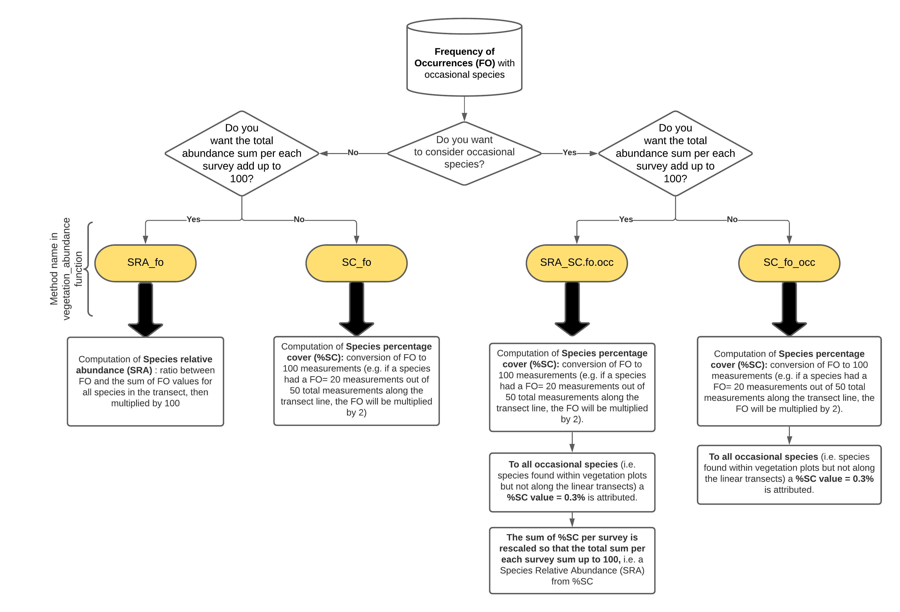

```{r, include = FALSE}
knitr::opts_chunk$set(
  collapse = TRUE,
  comment = "#>"
)
```


# iPastoralist

**An R package for vegetation data processing, characterization, and classification, with applications in grassland and pasture ecology, phytopastoral analysis, and phytosociology.**

*iPastoralist* provides tools for managing and analysing botanical composition data collected using point-quadrat (point-intercept) and phytosociological survey methods.

The package supports the conversion and standardization of vegetation data, the calculation of biodiversity, pastoral, and ecological indicators, and the numerical classification and floristic characterization of plant communities.

**Website:** https://marcopittarello.github.io/iPastoralist/

## Overview

The main functionalities of *iPastoralist* are organized into three complementary analytical components:

1. **Vegetation data preparation and conversion:** processing botanical survey data and converting species frequency or cover measurements into suitable quantitative formats.

2. **Vegetation characterization:** calculating biodiversity indices, Pastoral Value, ecological indicator values, and descriptors of floristic composition.

3. **Vegetation classification and interpretation:** supporting numerical vegetation classification, the identification of diagnostic and characteristic species, and the interpretation of vegetation groups according to phytopastoral and phytosociological approaches.

These components can be used independently or combined into an integrated workflow for vegetation analysis.

## When to use it

*iPastoralist* is designed to work with botanical composition data collected using two main survey methods:

- **Point-quadrat / pinpoint (point-intercept) method:** plant species are recorded at fixed intervals along a linear transect (Daget and Poissonet, 1971).
- **Phytosociological method:** plant species occurring within vegetation plots are recorded, and their cover is visually estimated.

For point-quadrat surveys, the package also supports datasets including **occasional species**, i.e., species recorded within a surrounding vegetation plot but not intercepted along the transect.

This is particularly relevant because point-intercept sampling may fail to detect rare or low-abundance species, which can nevertheless contribute to biodiversity and vegetation characterization.

The package is particularly suited to grassland and pasture studies, although several functions can also be applied to other vegetation types.

# Main features

## 1. Vegetation data preparation and conversion

*iPastoralist* provides functions to process botanical survey data and convert species frequency or cover measurements into quantitative values suitable for ecological and vegetation analyses.

### 1.1. Point-quadrat / pinpoint (point-intercept) method

The `vegetation_abundance()` function processes the **frequency of occurrence (FO)** of species recorded along linear transects, either with or without occasional species.

It allows the conversion of FO into two main quantitative measures.

**Species Relative Abundance (SRA)**

SRA is calculated as the ratio between the frequency of occurrence of a species and the sum of the frequencies of occurrence of all species recorded along the transect, multiplied by 100.

This measure expresses the proportional contribution of each species to the recorded vegetation composition.

**Species Percentage Cover (%SC)**

FO values can also be converted into frequency-based percentage cover estimates by standardizing the number of contacts to 100 measurement points.

For example, if a species is recorded at 20 out of 50 measurement points, its corresponding %SC is 40%.

For occasional species recorded within the vegetation plot but not intercepted along the transect, a conventional %SC value of 0.3% is assigned.

The processing and conversion procedure implemented in `vegetation_abundance()` is summarized in the following workflow.


{width=100%}

For further information about the available conversion methods and their implementation, see `vegetation_abundance()`.

### 1.2. Phytosociological method

The `PhytoCover()` function converts visually estimated species cover values (%) from phytosociological surveys into different cover-abundance scales and numerical values:

- **Braun-Blanquet cover-abundance scale** (Braun-Blanquet, 1932);
- **Van der Maarel cover-abundance scale** (Van der Maarel, 1979);
- **Dominance percentage** according to Tasser and Tappeiner (2005).

**Conversion table**

| Visually estimated cover (%) | Braun-Blanquet | Van der Maarel | Tasser and Tappeiner (%) |
|:---:|:---:|:---:|:---:|
| 0 | 0 | 0 | 0 |
| <1 | + | 2 | 0.3 |
| 1–5 | 1 | 3 | 2.8 |
| 6–15 | 2a | 5 | 10 |
| 16–25 | 2b | 5 | 20.5 |
| 26–50 | 3 | 7 | 38 |
| 51–75 | 4 | 8 | 63 |
| 76–100 | 5 | 9 | 88 |

These conversions facilitate the preparation of species cover data for subsequent analyses, including vegetation classification and comparisons of floristic composition.

For further details, see `PhytoCover()`.

## 2. Vegetation characterization

*iPastoralist* provides functions to characterize plant communities in terms of species diversity, pastoral characteristics, ecological indicator values, and floristic composition.

### 2.1. Biodiversity indices

The `biodiversity()` function calculates several biodiversity metrics, including:

- **Species richness:** number of plant species recorded within each vegetation survey;
- **Shannon diversity index:** measure combining species richness and the distribution of relative abundances;
- **Effective Number of Species (ENS):** transformation of diversity into an effective number of equally abundant species;
- **Maximum Shannon diversity:** theoretical maximum Shannon diversity for a given species richness;
- **Equitability (evenness):** measure describing how evenly species abundances are distributed.

These complementary metrics provide information about both the number of species and their relative contributions to the community.

For further details, see `biodiversity()`.

### 2.2. Pastoral Value

The `pastoral_value()` function calculates the **Pastoral Value (PV)** of vegetation based on the relative abundance of plant species and their specific forage quality.

PV is a synthetic index commonly used in phytopastoral studies to assess the forage potential of grassland and pasture vegetation.

It integrates:

- **Species Relative Abundance (SRA)**, expressing the proportional contribution of each species to the vegetation;
- **Index of Specific Quality (ISQ)**, reflecting the forage characteristics of individual plant species.

The resulting index supports the assessment and comparison of pasture vegetation types in relation to their potential forage value.

For further details, see `pastoral_value()`.

### 2.3. Ecological indicator values

The `ecological_indexes()` function calculates community-level ecological indicator values based on:

- **Landolt ecological indicator values**;
- **Ellenberg ecological indicator values**.

Calculations can be performed:

- With or without weighting by species abundance;
- Including or excluding occasional species.

These indicators provide information about the ecological characteristics of vegetation based on the environmental preferences of the species composing the plant community.

They can be used to characterize vegetation along environmental gradients and to support comparisons among vegetation surveys or groups.

For further details, see `ecological_indexes()`.

### 2.4. Floristic composition

The `first_ten_species()` function extracts the ten most abundant species for each vegetation survey, ranked in decreasing order of abundance.

This function provides a concise description of the main species contributing to vegetation composition.

The output is particularly useful for:

- Summarizing the floristic composition of individual vegetation surveys;
- Identifying the most abundant species;
- Supporting the interpretation of numerical classifications;
- Annotating dendrograms with species information.

For further details, see `first_ten_species()`.

## 3. Vegetation classification and interpretation

*iPastoralist* also provides functions supporting the **numerical classification of vegetation surveys** and the floristic characterization and ecological interpretation of the resulting vegetation groups.

These tools can be applied to datasets derived from point-quadrat or phytosociological surveys, using appropriate species abundance, cover, or presence-absence data.

The classification workflow aims to identify relatively homogeneous vegetation groups based on their floristic composition and to support their interpretation according to **phytopastoral** and **phytosociological** approaches.

### 3.1. Numerical vegetation classification

The package provides tools supporting the identification of vegetation groups based on floristic similarity.

The main objectives include:

- **Classification of vegetation surveys:** grouping relevés according to their floristic composition through numerical classification methods.
- **Evaluation of alternative classifications:** comparing alternative partitions of the vegetation dataset using statistical criteria.
- **Selection of the number of vegetation groups:** supporting the identification of an appropriate classification level by considering numerical criteria and the interpretability of the resulting groups.

These analyses provide a reproducible basis for identifying vegetation units that can subsequently be characterized in terms of floristic composition and ecological properties.

Numerical classification is intended to support, rather than replace, the ecological interpretation of vegetation communities.

### 3.2. Floristic characterization of vegetation groups

Once vegetation groups have been identified, *iPastoralist* supports their floristic characterization by distinguishing different roles of plant species within each group.

The main categories include:

**Diagnostic species**

Species showing a particular affinity or fidelity to one or more vegetation groups, identified using statistical measures of association or fidelity and appropriate significance tests.

Diagnostic species are particularly important for distinguishing vegetation units based on their floristic composition.

**Constant species**

Species occurring frequently within a particular vegetation group, independently of whether they are exclusive or diagnostic of that group.

Their frequency contributes to the description of the typical floristic composition of vegetation units.

**Dominant species**

Species characterized by relatively high abundance or cover within vegetation groups.

Dominant species are particularly important for describing vegetation structure and physiognomy.

**Companion species**

Additional species contributing to the floristic composition of vegetation groups without necessarily showing high fidelity, frequency, or dominance.

Together, these categories provide complementary information for describing and comparing vegetation communities.

### 3.3. Synoptic vegetation tables

*iPastoralist* supports the preparation of **synoptic vegetation tables**, summarizing species frequencies and floristic characteristics across vegetation groups.

These tables facilitate:

- Comparison of species occurrence frequencies among vegetation groups;
- Identification of diagnostic and constant species;
- Identification of dominant species based on abundance or cover;
- Description of the characteristic floristic composition of each vegetation group;
- Comparison of vegetation units for phytopastoral and phytosociological interpretation.

Synoptic tables provide a structured summary of the main floristic differences and similarities among vegetation groups.

### 3.4. Phytopastoral interpretation

The **phytopastoral approach** focuses on the identification and characterization of grassland and pasture vegetation types based on their botanical composition, ecological characteristics, and pastoral significance.

Vegetation groups obtained through numerical classification can be interpreted by considering:

- Floristic composition and dominant species;
- Species abundance and relative contribution to vegetation composition;
- Pastoral Value and forage characteristics;
- Biodiversity and ecological indicator values;
- Ecological and management-related characteristics of pasture vegetation.

This approach supports the identification and description of **phytopastoral vegetation types**, which can provide useful information for pasture assessment, vegetation monitoring, and management planning.

The characterization of phytopastoral types combines numerical results with the ecological and pastoral interpretation of vegetation composition.

### 3.5. Phytosociological interpretation

The **phytosociological approach** focuses on the identification and description of plant communities based on their floristic composition and the occurrence of diagnostic species.

Numerically derived vegetation groups can be characterized through:

- Diagnostic species and their fidelity to vegetation groups;
- Constant, dominant, and companion species;
- Synoptic tables summarizing the composition of vegetation units;
- Comparisons of floristic similarities and differences among vegetation groups;
- Ecological characteristics associated with vegetation units.

These outputs support comparisons with previously described vegetation communities and their possible attribution to **phytosociological syntaxa**, including associations, alliances, orders, and classes.

The final syntaxonomic attribution requires expert interpretation, taking into account the ecological and biogeographical context, floristic composition, diagnostic species, and relevant phytosociological literature.

### 3.6. Integrated vegetation classification workflow

Overall, *iPastoralist* supports an integrated analytical workflow that can be summarized as follows:

**Vegetation data preparation → Numerical classification → Floristic characterization → Synoptic vegetation tables → Ecological and phytopastoral or phytosociological interpretation**

The individual steps can be adapted to the objectives of each study and to the characteristics of the available vegetation data.

Numerical methods provide a reproducible basis for identifying vegetation groups, while their final interpretation depends on the ecological characteristics of the communities, the study objectives, and existing scientific knowledge.

# Installation

*iPastoralist* can be installed directly from GitHub using the `pak` package.

First, install `pak` if it is not already available:

```r
install.packages("pak")
```

Then install the latest version of *iPastoralist* from GitHub:

```r
pak::pak("MarcoPittarello/iPastoralist")
```

Once installed, load the package:

```r
library(iPastoralist)
```

For detailed function documentation, examples, and tutorials, visit the [iPastoralist website](https://marcopittarello.github.io/iPastoralist/).

# References

- Braun-Blanquet J (1932). *Plant sociology. The study of plant communities*. GD Fuller and HS Conard (Eds.). Authorized English translation of "Pflanzensoziologie". 1st ed. New York and London: McGraw-Hill Book Co. Inc.

- Daget P, Poissonet J (1971). A method of plant analysis of pastures. *Annales Agronomiques*, 22, 5–41.

- Tasser E, Tappeiner U (2005). New model to predict rooting in diverse plant community compositions. *Ecological Modelling*, 185, 195–211.

- Van der Maarel E (1979). Transformation of cover-abundance values in phytosociology and its effects on community similarity. *Vegetatio*, 39(2), 97–114.

# Author

**Marco Pittarello**

For more information, visit the [iPastoralist GitHub repository](https://github.com/MarcoPittarello/iPastoralist).

# License

*iPastoralist* is distributed under the GPL-3 license.
